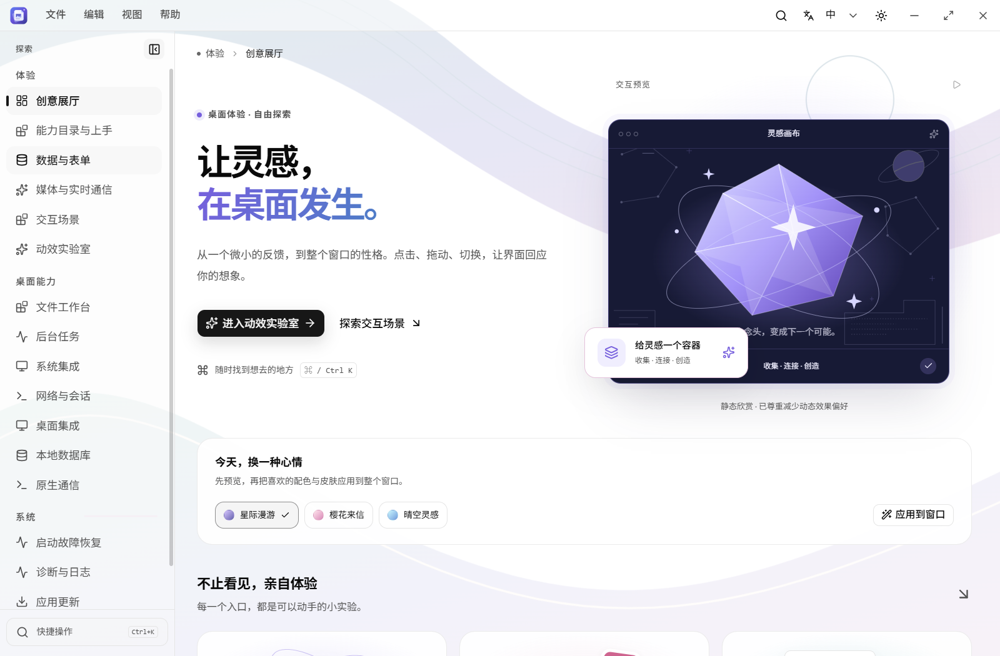
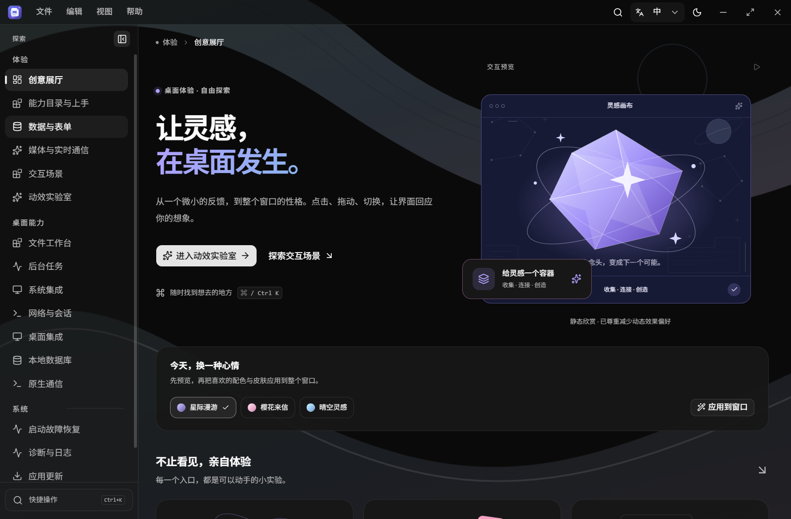

# Tauri Desktop Starter

[在线演示](https://yanchao001.github.io/tauri-desktop-starter/) · [English](./README.en.md) · [文档索引](./docs/README.md) · [发行记录](https://github.com/YanChao001/tauri-desktop-starter/releases) · [Code signing policy](./docs/code-signing-policy.md)

Tauri 2 + React 19 + TypeScript 的开源桌面应用基座，默认保留完整、可操作的演示，供派生项目按需裁剪。包含文件编辑与后台任务、SQLite 分页与备份恢复、复杂表格 / 表单、网络与系统集成，以及中英文、主题、动效和签名更新链路。更新公钥与正式代码签名由应用维护者配置。

桌面应用和在线演示共用同一份 React 源码。浏览器可操作展厅、数据工作室、网络 fixture、媒体与外观设置；系统能力页面说明对应的桌面功能。体验路径、源码定位、新增模块教程和裁剪方法见 [模块指南](./docs/demo-modules.md)。`minimal` 只改变展示，不删除模块或减小依赖。

## 桌面窗口：亮色与暗色

以下为当前源码在 Windows 原生 WebView 窗口中的截图，由隔离桌面构建生成。

| 亮色                                             | 暗色                                            |
| ------------------------------------------------ | ----------------------------------------------- |
|  |  |

[查看八种风格的桌面皮肤画廊](./docs/assets/skins-dark.png)。

## 快速开始

版本以 [`.nvmrc`](./.nvmrc)、[`package.json`](./package.json) 和 [`rust-toolchain.toml`](./rust-toolchain.toml) 为准。平台依赖见 [开发指南](./docs/development.md#环境要求)。

```bash
pnpm install --frozen-lockfile
rustup toolchain install
pnpm run doctor
pnpm app:dev
```

`node scripts/doctor.mjs` 可在依赖未安装时运行，检查工具版本和当前平台组件并给出修复提示，不会自动安装工具。

## 从源码运行

- `pnpm app:dev`：启动完整桌面应用，前端热更新，Rust 修改后重新编译。
- `pnpm dev`：浏览器访问 `http://localhost:1420`，可体验界面交互；原生能力页提供说明和导览，不执行系统操作。
- `pnpm build` / `pnpm preview`：构建并预览前端，仍没有 Rust 进程。
- `pnpm build:web`：将同一份前端构建到 `dist-web/`，用于在线演示；本地预览使用 `pnpm exec vite preview --outDir dist-web`，部署说明见 [开发指南](./docs/development.md#浏览器演示构建与部署)。

前端入口是根目录 [`index.html`](./index.html) → [`src/main.tsx`](./src/main.tsx) → [`src/App.tsx`](./src/App.tsx)；原生入口是 [`src-tauri/src/main.rs`](./src-tauri/src/main.rs) → [`lib.rs`](./src-tauri/src/lib.rs)。编辑 `src/` 和 `src-tauri/src/`；`dist/index.html` 是生成文件，不应手改或双击作为应用入口。

浏览器偏好保存在当前站点的 localStorage，与桌面原生存档分别维护。两种环境共用 HashRouter，在线演示可部署在 GitHub Pages 的项目子路径，并直接访问 `#/components` 等页面。

VS Code 已包含前端与 Rust 的 F5 配置，见 [调试说明](./docs/development.md#调试)。

## 已有能力

| 领域       | 实现                                                                                                                                       |
| ---------- | ------------------------------------------------------------------------------------------------------------------------------------------ |
| 体验演示   | 创意展厅提供指针光影、暂停及外观预设；交互组件以创作、反馈、资料收藏组成场景；动效实验室展示弹簧、共享布局、倾斜与 SVG 路径                |
| 外观       | 明暗 / 系统主题，主题色、圆角、字体、字号、动效；抽象、几何、水墨、星图、动漫、像素、植物、剪纸八种 SVG 风格，本机背景图片导入、填充与移除 |
| 语言       | 简体中文 / English；首次按系统偏好匹配，用户选择优先；标题栏与设置页共用语言注册表                                                         |
| 快捷操作   | 命令面板、菜单和快捷键共用命令注册表；设置搜索、侧栏折叠与键盘 / 拖拽调宽                                                                  |
| 恢复与存储 | 页面局部错误恢复；schema 3 设置迁移、原生原子写入、失败重试、revision 冲突处理与跨窗口同步；浏览器使用 localStorage                        |
| 原生桌面   | 单实例恢复、主 / 次窗口、常用尺寸预设与尺寸记忆、启动时记住位置 / 居中、托盘及登录启动；macOS 保留系统红绿灯                               |
| 数据可靠性 | SQLite 分页 / 搜索 / 排序、版本化批量回收与恢复、窗口持久草稿、完整逻辑备份 / 导入预览 / 事务恢复及启动隔离恢复                            |
| 文件与任务 | 原生选择 / 拖入、文本 / JSON / Markdown / 图片预览、原子保存与外部冲突；Rust 目录扫描 / SHA-256、排队 / 取消 / 重试 / 导出                 |
| 数据工作室 | 万条本地数据的过滤、排序、分页、虚拟滚动与批量部分失败；条件字段、交叉校验、动态明细和错误定位                                             |
| 网络与媒体 | 本地 fixture / 白名单 HTTPS、缓存、超时、取消与有限重试；安全 Markdown、附件、图表、WSS 与固定 worker                                      |
| 系统集成   | 通知、文本剪贴板、预定义全局快捷键、深链 / 文件关联、工作区恢复与专用系统凭据项                                                            |
| IPC        | Rust 命令生成 TypeScript 绑定，统一结构化错误，页面只调用 `src/lib/tauri.ts`                                                               |
| 诊断与更新 | 环境 / 存储 / 运行状态报告、脱敏日志预览；GitHub Releases 更新源、检查 / 下载 / 安装 / 重启状态，配置公钥后启用验证                        |
| 验证与发布 | 前端 / 脚本 / Rust 测试、真实桌面 E2E、三端 CI、版本化分发目录和 SHA-256 清单                                                              |

内置皮肤使用程序化 SVG，自定义背景支持导入本机图片，不加载远端素材；高对比度模式会移除装饰。应用内中英文覆盖模板界面与自带 IPC 示例，安装器和系统组件有各自的语言设置。

导航分为体验、桌面能力、系统三组。展厅风格先局部预览，点击应用才修改窗口偏好，并可撤销本轮换装；组件场景的数据只保留在当前页面，不发送邮件或写入笔记数据库。展厅与动效实验室提供暂停，持续演示按离屏、文档隐藏和减少动效偏好停止或降级，约定见 [界面规范](./docs/conventions/ui-guidelines.md#动效)。

关闭、明确退出、重启及安装更新经过未保存工作协商：可以保存、放弃或取消，保存失败保留输入；后台任务可以等待完成或合作取消。开启后台运行且托盘创建成功时，关窗隐藏到托盘，离页 / 隐藏不终止任务。更新默认缺少公钥，不发起更新请求；Windows 安装更新可能结束当前进程并由安装器重新打开，配置见 [自动更新](./docs/build-release.md#自动更新)。本地会话不构成远程 OAuth，配置或 CI 覆盖不代表已经完成签名及各平台安装验收。

## 创建派生项目

品牌字段集中在 [`app.config.json`](./app.config.json)，前端从 [`src/config/app.ts`](./src/config/app.ts) 使用。准备一份 JSON，填写或覆盖应用名、简称、包名、唯一反向域名标识符、描述、作者、仓库与文档地址：

```bash
pnpm init:project --config ../my-app.json --dry-run
pnpm init:project --config ../my-app.json
# 需要精简初始界面时，在两条命令中都增加 --minimal
pnpm verify
```

脚本预检配置、版本、入口和路径，再同步品牌与应用身份。失败时恢复本轮已替换的文件；遇到并发编辑则保留用户修改与原备份并报告冲突。`--dry-run` 不写文件；`--minimal` 设置精简默认模式，源码演示仍保留。

图标与安装器位图、安全报告渠道、许可证归属、签名和更新公钥需另外配置。初始化不会生成或修改签名私钥；版本使用 `pnpm version:set`。详细字段和边界见 [项目初始化](./docs/development.md#项目初始化)。发布后应保持应用 `identifier` 稳定，它关联安装升级与用户数据目录。

派生时还要为 `tdemo` 深链 scheme 和 `.tdemo` 文件关联选择自己的名称，并同步原生解析、配置、词典、能力目录与测试。删除数据库或更新器等模块须按 [实际裁剪配方](./docs/demo-modules.md#实际裁剪模块) 同步清理路由、IPC、状态、依赖、权限、翻译与验证，不能只隐藏导航。

视觉资源只维护 `resources/branding/` 下的 SVG，执行 `pnpm branding:generate` 即可派生完整的 ICO / ICNS / PNG / BMP；`pnpm branding:check` 和 CI 检查资源是否同步。标题栏与 favicon 直接共用 SVG，系统图标和安装器使用平台格式，详见 [品牌资源与安装器](./docs/build-release.md#安装器外观)。

## 目录结构

```text
app.config.json              品牌与部署默认值
resources/branding/          共用标志和安装器插画的 SVG 源
src/
  config/                    品牌入口
  routes.tsx                 页面、导航与命令可用性的路由来源
  commands/                  命令描述、快捷键匹配、设置搜索索引
  layouts/                   应用外壳
  pages/                     创意展厅、交互场景、动效实验室及桌面功能页
  features/                  数据工作室、网络、媒体与能力目录的模型 / 组件
  components/                外壳、showcase/、motion-lab/；ui/ 为 shadcn 组件
  hooks/                     主题切换、动效活动策略与原生资源生命周期
  styles/                    共用页面层次与各场景样式
  providers/                 设置、语言、命令与未保存工作 Context
  i18n/                      中英文词典和 locale 注册表
  lib/                       原生门面、生成绑定、设置模型与同步、工具
src-tauri/
  src/lib.rs                 插件、状态、命令与生命周期组装
  src/commands.rs / *_commands.rs  基础与领域 IPC 边界
  src/{storage,database,workbench,lifecycle,recovery,desktop,updater}.rs
  src/bindings.rs            Rust 命令与类型导出注册
  capabilities/              核心 / 插件权限
  tauri*.conf.json           主、平台与 E2E 配置
scripts/                     初始化、诊断、绑定、版本、构建、收集与清理
e2e/                         隔离构建、跨进程恢复与真实桌面断言
docs/                        工程文档，入口 docs/README.md
.vscode/                     工作区设置、任务与 F5 调试入口
```

原生调用、状态与安全边界见 [架构说明](./docs/architecture.md)。已有 shadcn 组件在 `src/components/ui/`；添加组件使用 `pnpm dlx shadcn@latest add <name>`，升级时保留本地行为修复。

## 验证

```bash
pnpm verify          # 格式、品牌资源、lint、TS、前端 / 脚本测试、版本与前端构建
pnpm build:web       # 验证可部署的浏览器演示构建
pnpm test:browser    # 已构建dist-web后的子路径、键盘与axe冒烟（先安装Playwright浏览器）
pnpm bindings:check  # Rust IPC 导出与已提交的绑定一致
pnpm test:e2e        # 构建隔离测试应用，运行真实桌面 E2E
```

日常开发按 [改动范围](./docs/testing.md#日常验证范围) 运行相关检查，无需每次提交执行整套验证。`pnpm verify` 不编译 Rust。修改原生端还需执行 [Rust 检查](./docs/testing.md#rust-测试)。E2E 通过测试 feature、独立 `.e2e` 标识和临时数据目录运行；独立应用进程覆盖启动、真实 IPC、中英文、窗口预设、多窗口同步、SQLite 冲突处理，以及设置、位置策略和笔记的重启恢复。三端运行环境和验证边界见 [测试规范](./docs/testing.md)。

依赖审计与间接依赖告警见 [安全规范](./docs/security.md#依赖审计)。审计结论取决于当前锁文件和最新漏洞数据库，不能以历史扫描结果代替发布前检查。

## 构建产物

```bash
pnpm app:build     # 安装包
pnpm app:portable  # Windows 便携 exe 与使用说明
```

最终交付统一在 `artifacts/<version>/<target-triple>/`，以下以版本 `0.1.0` 的 Windows x64 构建为例：

```text
artifacts/0.1.0/x86_64-pc-windows-msvc/
  installers/       # nsis/、msi/ 等安装包与 manifest.json
  portable/         # exe、使用说明.txt 与 manifest.json
```

每次只替换当前版本 / target 下的整类 `installers/` 或 `portable/`，保留其他版本、平台和另一类产物。清单记录普通文件 SHA-256，目录包记录类型。Windows 提供 NSIS / MSI，macOS 提供 DMG / APP，Linux 提供 DEB / RPM / AppImage。

`dist/` 保留桌面构建所用的前端输出；`dist-web/` 保存可部署的浏览器演示；`src-tauri/target/` 保留 Cargo 缓存和 Tauri 原始输出。E2E 失败截图与日志位于 `artifacts/e2e/`。

需要保留正式版本包和实际依赖时，使用跨平台临时清理入口，先预览再执行：

```bash
pnpm clean:temporary --dry-run
pnpm clean:temporary
```

所有清理模式默认执行删除，添加 `--dry-run` 才只预览。`pnpm clean:artifacts` 删除整个 `artifacts/`，`pnpm clean` 清理默认构建目录和生成 schema，`pnpm clean:all` 还会删除依赖。各模式范围见 [清理说明](./docs/development.md#清理构建产物)。

便携版仍依赖系统 WebView2，设置、数据库与日志写入当前用户目录；免安装不代表数据跟随 exe 移动。当前便携版内安装更新会转为安装版，保留免安装形态需手动下载新版 portable。`--no-bundle` 不会执行安装器签名。参数、签名、更新包与发布步骤见 [构建与发布](./docs/build-release.md)。

## 文档与协作

现有结构适合作为桌面产品的工程起点。它已覆盖基座分层、类型化 IPC、测试和发布链路；展厅、交互场景与笔记示例不代表完整业务系统。多业务域和多人开发应按 [规模化开发指南](./docs/engineering-at-scale.md) 落实模块契约、负责人、兼容策略、性能预算和恢复验证。指南区分当前能力与需要产品团队实施的治理，不以文档齐全代替实际验证。

完整入口：[文档索引](./docs/README.md)。编码智能体的工作入口见 [AGENTS.md](./AGENTS.md)。开发规范见 [代码风格](./docs/conventions/code-style.md)、[界面规范](./docs/conventions/ui-guidelines.md) 和 [Git 协作](./docs/conventions/git-workflow.md)；贡献流程见 [CONTRIBUTING.md](./CONTRIBUTING.md)，安全报告见 [SECURITY.md](./SECURITY.md)，签名范围与审批见 [代码签名策略](./docs/code-signing-policy.md)。
