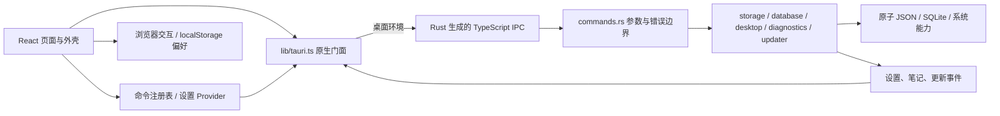

# 架构说明

本文说明当前运行入口、模块职责和数据边界。新增页面、命令或存储能力时，先复用已有入口；目录按实际职责拆分，不预建空的业务层。多人、多业务域场景的依赖方向、责任与设计门槛见 [规模化开发指南](./engineering-at-scale.md)，其中的演进示例不代表当前已实现。

## 运行时结构



前端由根 [`index.html`](../index.html) 加载 [`main.tsx`](../src/main.tsx)，挂载 App。App 组合设置、语言、主题、命令 Provider、全局 DemoMotion 与 HashRouter；AppShell 组合标题栏、分组侧栏、轻量位置提示与页面。原生由 [`main.rs`](../src-tauri/src/main.rs) 调用 [`lib.rs`](../src-tauri/src/lib.rs)，后者只组装插件、共享状态、命令和生命周期。

同一份 `src/` 支持桌面和浏览器两种运行环境。`pnpm app:dev` 启动 Rust 与 WebView，桌面构建通过 Tauri 自定义协议加载前端；`pnpm dev` 与在线演示在浏览器运行交互场景和外观设置，原生能力页面通过 NativePage 提供说明，实际系统调用仍由门面进行环境检查。

两种环境共用 HashRouter，路由位于 URL 片段中，页面刷新不要求静态托管服务解析应用路由。`pnpm build:web` 使用相对资源路径生成 `dist-web/`，适用于 GitHub Pages 项目子路径；桌面前端仍输出到 `dist/`。构建、预览和部署方法见 [浏览器演示](./development.md#浏览器演示构建与部署)，源码入口与交付目录见 [README](../README.md#从源码运行)。

## 模块职责

| 位置                                                          | 职责                                                     |
| ------------------------------------------------------------- | -------------------------------------------------------- |
| `src/routes.tsx`                                              | 懒加载页面、路径、导航分组、文案及演示页面标记           |
| `src/config/app.ts` / `app.config.json`                       | 品牌、默认演示 / 精简模式、部署更新默认值                |
| `src/commands/` / `providers/commands.tsx`                    | 命令描述、上下文可用性、菜单 / 面板 / 快捷键共用执行入口 |
| `src/components/`                                             | 交互与外壳；`ui/` 为 shadcn 原子组件                     |
| `src/components/showcase/` / `motion-lab/`                    | 交互场景与动效实验，页面内数据与播放状态                 |
| `src/hooks/use-demo-motion.ts` / `components/demo-motion.tsx` | 文档可见性、场景离屏、用户偏好与全局 MotionConfig        |
| `src/styles/`                                                 | 共用页面层次、导航与独立场景样式                         |
| `src/providers/settings.tsx`                                  | 设置状态、保存反馈与生命周期                             |
| `src/lib/settings-model.ts` / `settings-sync.ts`              | schema 迁移、校验、局部字段合并、原生 revision 同步      |
| `src/i18n/`                                                   | 类型化词典、语言注册表、系统匹配与翻译回退               |
| `src/lib/tauri.ts`                                            | 系统能力的唯一前端门面；生成绑定是允许的底层例外         |
| `src-tauri/src/commands.rs`                                   | IPC 参数边界与服务编排                                   |
| `src-tauri/src/bindings.rs`                                   | 命令 / DTO 导出注册；Rust 是 IPC 契约来源                |
| `src-tauri/src/blocking.rs`                                   | 将同步存储、数据库与系统探测适配到阻塞任务池             |
| `storage.rs` / `database.rs`                                  | 原子设置存储与 SQLite 迁移、事务、并发版本               |
| `desktop.rs` / `autostart.rs`                                 | 窗口复用、托盘、后台行为与平台自启动                     |
| `window_geometry.rs`                                          | 按窗口保存逻辑尺寸，适配 DPI 与显示器工作区变化          |
| `diagnostics.rs` / `updater.rs`                               | 诊断脱敏及更新策略、下载 / 安装状态                      |
| `resources/branding/` / `scripts/branding.mjs`                | SVG 设计源与平台图标、安装器位图的可复现生成             |
| `scripts/fs-utils.mjs`                                        | 初始化与版本设置共用的路径校验、文件暂存、冲突检测与回滚 |

小领域继续放在现有页面、组件、Hook 和原生服务中；同一业务领域需要独立维护一组页面、数据与组件时，再按 [业务模块与依赖方向](./engineering-at-scale.md#业务模块与依赖方向) 引入 `features/<domain>/`。不要为消除几行相似代码增加空壳层。

## 页面与演示边界

导航由 `APP_ROUTES.group` 和 `NAVIGATION_GROUPS` 生成，分组不改变原有 URL 或命令 ID：

| 分组     | 页面                                                       |
| -------- | ---------------------------------------------------------- |
| 体验     | `/` 创意展厅、`/components` 交互场景、`/motion` 动效实验室 |
| 桌面能力 | `/desktop`、`/database`、`/bridge` 原生通信                |
| 系统     | `/diagnostics`、`/updates`、`/settings`                    |

精简模式隐藏标记为 `demoOnly` 的导航和命令，首页呈现桌面功能、本地笔记与设置入口。外壳仅显示随内容滚动的位置提示；各页负责自己的标题与层次，不再重复展示固定页标题栏和版本号。侧栏底部复用命令面板入口。页面路径变化时重置主滚动区，不抢导航焦点；同页查询参数变化保留设置定位行为。

创意展厅的 SVG 雕塑和三种风格属于交互预览。选择预设不会写设置，点击应用才通过现有设置 / 主题入口修改外观；撤销恢复本轮首次应用前的外观。组件页的创作预览、演示协作者、通知与资料收藏使用页面内状态，切换场景保留输入，离开或重载页面不承诺恢复。示例资料与应用内通知不代表账户、邮件或后台服务，持久笔记仍由原生 SQLite 页面管理。

动效实验室将弹簧、共享布局、指针倾斜和 SVG 路径拆为独立场景。`motion/react` 提供运动与布局能力；DemoMotion 统一减少动效策略，useDemoMotion 判断场景活动状态。CSS 持续动画及命令式播放仍需消费活动状态并在退出时清理，MotionConfig 不会自动暂停所有动画。具体约定见 [动效规范](./conventions/ui-guidelines.md#动效)。

设置页将窗口与布局放在同一工作区，版本和资源链接收进可折叠的关于区，保留设置搜索锚点与保存反馈。浏览器中的原生能力页通过 NativePage 说明实际能力与下一步入口，不渲染伪造的 IPC 成功结果。

## 命令与桌面交互

菜单、命令面板和快捷键通过同一命令注册 / 执行入口调用。命令的可用性取决于当前路由、演示模式与原生环境；浏览器预览不会执行原生操作。快捷键匹配集中处理 Cmd / Ctrl、输入框、输入法组合输入、重复按键和冲突，避免各组件分别监听全局按键。

设置搜索索引指向稳定的控件锚点，命令面板可导航并聚焦对应设置。侧栏折叠、宽度和模式进入同一设置模型；路由表中的 `demoOnly` 控制演示页可见性，精简模式不删除源码。

窗口标签固定为 `main` 和 `secondary`，再次打开次窗口会显示并聚焦已有实例。桌面状态在 Builder 上提前注册，单实例插件最先初始化；重复启动回调只合并唤醒请求并投递后台任务，不同步等待窗口创建或显示。两个窗口共用原生设置和数据库，而各自保留渲染状态。

主窗口配置 `create: false`，由 setup 在设置、数据库和共享状态就绪后从阻塞任务池创建，避免 WebView 创建占住启动事件循环，也防止页面访问尚未注册的状态。窗口初始隐藏，前端两次动画帧回调后通过 `complete_frontend_startup` 握手显示；首帧完成前的重复唤醒不强制显示空白内容。Rust 在窗口创建成功后安排三秒显示兜底，关闭或销毁时取消，且不恢复用户已最小化的窗口。兜底显示不代表前端已正确渲染，启动阶段日志的含义见 [启动排障](./troubleshooting.md#启动慢或重复启动后卡死)。

窗口状态插件恢复上次位置和显示状态，排除尺寸、装饰与可见性。尺寸由几何模块统一维护，平台配置决定装饰，首帧握手决定显示时机。持久偏好 `windowPosition` 控制新建窗口的初始位置：默认 `remember` 沿用位置恢复，`center` 请求启动居中；切换策略不移动当前窗口，重复激活已有窗口也不重新定位。macOS 用平台配置保留系统红绿灯；平台配置的 `app.windows` 数组整体替换，`create: false` 等生命周期字段需同步。

窗口状态插件之后运行几何适配插件，按窗口保存逻辑尺寸，并监听 DPI、窗口事件及显示器布局；在远程桌面或工作区变化后约束到可用范围。窗口就绪回调只记录初始策略与修正任务，不在持有插件锁的回调中同步改动几何，避免 Windows 消息重入导致死锁；几何存档写盘由后台 worker 处理。运行期间普通移动不持续吸附屏幕边缘，临时缩小保留首选尺寸，最大化 / 全屏 / 最小化时不主动修改位置。迁移限制与诊断步骤见 [排障手册](./troubleshooting.md#远程桌面断开后窗口过大或落在屏幕外)。

设置页提供常用窗口尺寸预设，以逻辑像素（DIP）标注宽高；选择后立即应用到当前窗口并记忆，超过窗口配置或当前工作区范围的预设不可选。手动拖动仍可产生其他尺寸，界面显示实际值，不强制匹配某个预设。最大化、最小化或全屏窗口应用尺寸前先还原。尺寸修改在主线程执行，命令在工作线程等待并完成原子写盘后才返回。`window-geometry.json` 是尺寸的权威存档，旧窗口状态中的物理尺寸仅用于首次迁移，避免双重恢复覆盖用户设定。

新窗口创建时捕获最后已保存的启动位置策略和可用的最近正常位置。位置记录在进程启动时读取窗口状态存档，之后由正常移动更新内存，次窗口重建使用最新记录；初始位置来源在复核期间保持固定，按当前工作区约束，避免异步请求后的旧坐标覆盖恢复目标。居中以该位置选择显示器，优先取重叠面积最大的有效工作区，原显示器断开时取最近的有效工作区；保留记忆的逻辑尺寸，并扣除原生边框。创建返回后、首帧握手显示前和超时显示前共用初始布局入口，显示前准备，窗口可见后有限复核实际尺寸、外框与位置；确认完成或达到上限后结束初始定位，不阻塞显示或持续回中。启动居中先调整正常位置，再恢复原显示状态；异步还原未完成时保留原状态并放弃本次居中。后续拖动与再次唤醒不重复执行初始定位。

默认正常关闭窗口；启用后台运行且托盘可用时，关闭请求改为隐藏。明确的「退出」调用 `quit_app` 结束应用。自启动由用户主动开关，测试构建禁止读写系统自启动项。

## 通信机制

Rust `tauri-specta` 从命令与 DTO 生成 [`src/lib/generated/bindings.ts`](../src/lib/generated/bindings.ts)。开发者实现命令、添加 `#[specta::specta]` 并在 `bindings.rs` 注册，然后运行：

```bash
pnpm bindings:generate
pnpm bindings:check
```

页面和 Hook 只依赖 `lib/tauri.ts`；门面加载生成的 `commands` 并归一化成功 / 失败。不要手改生成文件、在页面拼命令字符串，或额外维护一套返回 DTO。

命令返回 `NativeResult<T>`，错误统一包含 `code`、`message`、`retryable`。前端按稳定 code 决定文案和行为，不解析错误文本，也不对对象直接 `String(error)`。生成类型检查源码契约，不能替代 Rust 入参校验、数据大小限制与路径边界。

事件通过门面订阅：设置快照、笔记变更和更新进度各有明确语义。订阅异步返回取消函数；组件卸载、StrictMode 重建或注册晚到时都必须取消，不能把 Promise 当 cleanup。事件用于通知失效与刷新，写入结果仍以命令返回为准。

## 状态管理与设置迁移

组件局部状态使用 React 状态；跨页偏好由 SettingsProvider 管理，命令上下文由 CommandsProvider 管理。当前没有引入 Zustand、TanStack Query 或通用表单状态库。

设置文档的版本由 [`settings-model.ts`](../src/lib/settings-model.ts) 维护，当前为 schema 2：

- 读取旧版无版本扁平存档和 schema 1 包装结构，迁移主题、外观与布局字段。
- 未提供主题时兼容旧 `theme` 存储键；旧纹理背景映射到现有 SVG 插画。
- 字段按白名单规范化；侧栏宽度限制在支持范围，未知字段不写回。
- 未来 schema 显示不兼容错误并阻止自动覆盖；明确重置后才允许替换。
- 首次语言按系统偏好匹配 zh / en，已保存选择优先；重置保留用户语言。
- 启动位置策略 `windowPosition` 支持 `remember` / `center`；旧存档缺少该字段时使用 `remember`，保持 schema 2 的兼容读取。

恢复默认设置会重置偏好，以及所有已打开窗口和已记忆窗口的尺寸；默认尺寸取各窗口配置，并约束到可用工作区。启动位置策略恢复为 `remember`，保留当前窗口位置，屏外位置仍经过必要的可见性修正。尺寸恢复与偏好保存依次完成，分别具有独立持久化边界；任一步失败均保留确认框及错误，允许重试，不显示完成提示。

原生设置是权威快照，存于配置目录的 `settings.json`，采用原子替换和 revision compare-and-swap。前端设置模型负责字段迁移与未来 schema 保护；Rust 校验 JSON 结构、大小、深度和原生使用的字段。SettingsSync 将未提交字段与在途修改分开合并，冲突后读取新快照并有限重试；保存失败保留用户修改，界面提供状态和重试。跨窗口事件只接受新的 revision，不能让旧事件覆盖新状态。

浏览器模式使用当前站点的 localStorage 保存偏好，交互场景的数据按各页面的生命周期维护；在线演示不具备原生 SQLite、系统窗口或更新安装能力。原生模式保留本地缓存用于初始渲染与旧设置迁移，成功保存仍以原生快照为准。主题也纳入同一模型，避免 next-themes 与多窗口分别保存出两份事实。

## 数据存储

| 数据           | 位置与边界                                                                   |
| -------------- | ---------------------------------------------------------------------------- |
| 设置、窗口存档 | Tauri `appConfigDir`；损坏设置备份后恢复，前端对未来设置 schema 阻止自动写回 |
| 笔记数据库     | `appDataDir/starter.sqlite3`，由 Rust `rusqlite` 持有连接                    |
| 应用日志       | `appLogDir`，轮换规则见 [排障手册](./troubleshooting.md#先看日志)            |
| 浏览器缓存     | WebView / 浏览器的 localStorage，仅存非敏感偏好                              |
| 用户凭据       | 当前未接入；需要时使用系统钥匙串，不存明文 JSON / SQLite / localStorage      |

SQLite 用 `PRAGMA user_version` 标记数据库 schema，迁移在事务中完成；遇到未来数据库版本拒绝修改。笔记查询参数化，更新检查 `expectedVersion`，冲突要求重新加载；不向前端暴露任意 SQL、数据库路径或文件系统权限。

笔记草稿仅保留在当前 WebView 内存，支持跨路由返回；点击保存成功后才进入数据库。关闭窗口、退出进程或更新重启前需先保存；浏览器 `beforeunload` 提示不能覆盖 Tauri 原生关闭、托盘退出等路径，当前没有跨原生退出的草稿保存协调协议。

数据目录由 Tauri 路径 API 决定，不写入 exe 所在目录。恢复默认设置更新偏好与窗口尺寸存档，不删除笔记、日志或 WebView 数据。测试 feature 使用独立用户目录，见 [E2E 隔离](./testing.md#真实桌面-e2e)。

## 恢复、诊断与更新

App 外层错误边界处理根渲染失败；路由内的恢复边界保留外壳和导航，可重试当前页面。加载、保存和删除失败应保留输入及已有数据，并提供明确下一步。

诊断报告包含应用 / Tauri / 平台信息、窗口、设置 revision、数据库版本、桌面状态和有限日志。记录前端异常有速率限制，预览日志会脱敏；复制或反馈前仍需人工复核，不把完整设置、笔记或环境变量作为诊断内容。

更新由 Rust 持有检查结果和安装句柄，前端订阅状态 / 进度。默认 GitHub 地址来自品牌配置，公钥为空时禁用且不请求网络。配置、签名顺序及部署覆盖见 [自动更新](./build-release.md#自动更新)。更新不能用前端任意 URL 绕开固定策略，也不允许跳过签名验证。

## 安全边界

核心与插件权限在 [`capabilities/default.json`](../src-tauri/capabilities/default.json) 中分配；自定义命令的应用 ACL 与插件 capability 是不同机制，详见 [能力最小化](./security.md#能力最小化)。当前主 / 次窗口均为可信本地界面，不在其 WebView 中加载第三方网页。

桌面构建的 CSP 限制脚本和网络来源，外链统一交给系统浏览器。数据库、设置、更新和自启动由限定服务负责；新增页面不因此获得通用文件、Shell 或 SQL 能力。浏览器演示遵循浏览器权限与同源存储边界，不包含可调用的 Rust 进程。

## 扩展原则

技术选型与协作决策见 [ADR](./adr/README.md)。扩展前先确认实际需要：新增语言复用 locale 注册表，新增操作复用命令注册表，新增原生能力复用生成绑定与门面。跨模块、数据兼容或发布行为的变更先完成 [设计影响分析](./engineering-at-scale.md#设计评审与-adr-门槛)。当前桌面配置不包含移动端交付，新增平台、远程内容或敏感数据存储都需要单独设计和验证。
