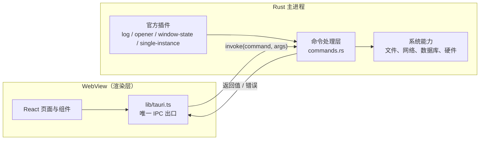

# 架构说明

## 一句话

Rust 负责"能做什么"，WebView 负责"长什么样"，两者只通过 `invoke` 与事件通信。

## 运行时结构



要点：

- WebView 里跑的是标准的 Web 应用，没有 Node 环境，碰不到文件系统。
- 所有系统能力必须先在 Rust 侧写成命令，再暴露给前端。
- 前端能调什么，由 `src-tauri/capabilities/default.json` 决定，默认拒绝。

## 前端分层

依赖方向是单向的，反过来就是设计出了问题：

```
routes.tsx ── 路由与导航的唯一数据源
     │
     ▼
layouts/ ──> pages/ ──> components/
     │           │            │
     └───────────┴────────────┴──> hooks/ ──> lib/ ──> @tauri-apps/api
```

| 层            | 职责                                      | 不该做的事                          |
| ------------- | ----------------------------------------- | ----------------------------------- |
| `routes.tsx`  | 路由路径、标题、图标、页面组件            | 不放业务逻辑                        |
| `layouts/`    | 应用外壳（侧边栏、顶栏、内容区）          | 不写页面内容                        |
| `pages/`      | 路由级编排、组合组件                      | 不写复杂业务逻辑，不直接调 `invoke` |
| `components/` | 可复用的展示与交互单元                    | 不感知路由，不直接读全局状态        |
| `hooks/`      | 可复用的 React 逻辑（副作用、订阅、状态） | 不含 JSX，不承载业务规则            |
| `lib/`        | 纯 TS：IPC 封装、格式化、校验             | 不含 JSX，不 import React           |

**唯一例外**：`components/ui/` 是第三方生成的原子组件，不受上述约束。

`layouts/` 和 `components/` 的分界线就一条：**要不要知道"当前在哪一页"**。
`AppShell` 用 `useLocation`、渲染 `Outlet`，所以它在 `layouts/`。

`components/error-boundary.tsx` 包在 `App` 外层（见 `main.tsx`）。这不是可选项：
窗口启动时是隐藏的，组件树一崩，用户看到的是 Rust 兜底线程弹出的空白窗口，
没有任何可反馈的信息。错误边界至少能把错误文本留在屏幕上。

**硬规则**：`@tauri-apps/*` 只允许出现在 `src/lib/tauri.ts`。
所有 IPC 调用收敛到这一个文件，带来三个好处：

1. 换实现（比如接入 `tauri-specta` 生成类型）只改一个文件。
2. 写测试时可以整体 mock 掉。
3. 一眼能看出这个应用到底用了哪些系统能力。

这条规则**由 ESLint 强制**，不是靠自觉：`eslint.config.js` 里同时配了
`no-restricted-imports`（静态 import）和 `no-restricted-syntax`（动态 `import()`）。
后者必不可少——本工程的 Tauri 调用全是动态引入，只配前者等于没配。

## 业务代码放哪

模板只有展示页，没有业务。真写起来按这个顺序找位置，别一上来就加层：

| 你要写的东西           | 放哪                                                 |
| ---------------------- | ---------------------------------------------------- |
| 一个页面               | `pages/`                                             |
| 只在这个页面用的子组件 | 和页面同目录，需要时把页面变成 `pages/xxx/index.tsx` |
| 跨页面复用的组件       | `components/`                                        |
| 一段带状态的复用逻辑   | `hooks/`                                             |
| 纯函数、格式化、校验   | `lib/`                                               |
| 需要 Rust 参与的能力   | `lib/tauri.ts` 加封装 + `src-tauri/src/commands.rs`  |

**什么时候升级成 `features/<domain>/`**：同一个领域同时出现「页面 + 组件 + 请求封装」，
且该领域文件超过 10 个时。提前建空目录只增加导航成本，不产生结构收益。

### 命令变多以后

`lib/tauri.ts` 现在是单文件。命令超过 5 个、或出现明显领域划分时，改成目录：

```
lib/tauri/
  index.ts      对外门面，页面只从这里 import
  env.ts        isTauri
  invoke.ts     统一 invoke 封装（错误归一化）
  app.ts        应用级命令
  fs.ts         文件相关命令
```

对外路径仍是 `@/lib/tauri`，调用方不用改。

## 通信机制

### 请求 / 响应（invoke）

前端调 Rust，等返回值。适合"取数据、执行动作"。

```ts
// lib/tauri.ts
export async function invokeGreet(name: string): Promise<string> {
  const { invoke } = await import("@tauri-apps/api/core");
  return invoke<string>("greet", { name });
}
```

Rust 侧返回 `Result<String, String>`，`Err` 会原样 reject 到前端。
模板刻意让 `greet` 对空名称返回错误，而不是在页面里兜底——
**校验放在边界，错误由调用方展示**。照着这个写，错误链路天然是通的。

命令变多、同一类错误需要不同的用户提示或重试策略时，把 `String` 升级为结构化错误，
前端按类型分支，而不是解析错误字符串：

```rust
#[derive(Debug, serde::Serialize)]
#[serde(tag = "kind", content = "message")]
pub enum CommandError {
    Validation { message: String },
    NotFound { message: String },
    Io { message: String },
}

#[tauri::command]
pub fn read_config() -> Result<String, CommandError> {
    // ...
}
```

```ts
type CommandError = { kind: "Validation" | "NotFound" | "Io"; message: string };

const message = await invoke<string, unknown[]>("read_config").catch(
  (error: CommandError) => {
    // 按 error.kind 决定提示文案与是否重试
  },
);
```

演进时机：只有一种错误时保持 `String`，错误分叉前不加层。

注意：`invoke<T>` 的泛型**不做运行时校验**，它只是一个断言。跨进程边界的数据要当成不可信输入，必要时用 zod 校验。

### 事件（emit / listen）

Rust 主动通知前端，或窗口之间广播。适合"进度更新、后台任务完成、菜单点击"。
当前工程未使用，需要时：

```rust
app.emit("download-progress", 42)?;
```

```ts
import { listen } from "@tauri-apps/api/event";
const unlisten = await listen<number>("download-progress", (e) =>
  setProgress(e.payload),
);
```

`useEffect` 里注册监听必须返回 `unlisten`，否则组件卸载后仍会响应。

## 状态管理

按这个顺序升级，不要一上来就上库：

| 场景                                   | 方案                      | 现在有吗         |
| -------------------------------------- | ------------------------- | ---------------- |
| 单个组件内部                           | `useState` / `useReducer` | 有               |
| 兄弟组件共享                           | 状态提升到共同父级        | 有               |
| 跨页面 UI 状态（侧边栏折叠、当前项目） | Zustand                   | 未安装，需要时装 |
| 来自数据库/接口、需要缓存与失效        | TanStack Query            | 未安装           |
| 表单 + 校验                            | react-hook-form + zod     | 未安装           |

判断标准：**能靠组件树解决的就别引入全局状态**。全局状态每多一个，调试成本就多一分。

## 数据存储

| 数据                            | 存哪                         | 原因                                |
| ------------------------------- | ---------------------------- | ----------------------------------- |
| UI 偏好（主题、语言、窗口布局） | `localStorage`               | 不需要 Rust 参与，重启即恢复        |
| 业务数据                        | SQLite（`tauri-plugin-sql`） | 事务、索引、迁移，比 JSON 文件可靠  |
| 导出文件、缓存、日志            | `appDataDir`                 | 安装目录（Program Files）没有写权限 |
| 令牌、密钥                      | 系统钥匙串（`keyring` 插件） | 不落明文，不写进 localStorage       |

**绝对不要**把数据写到 exe 所在目录。Windows 下装在 `Program Files` 时是只读的，
开发机上能跑、装完就崩，这类问题排查成本极高。

获取路径：

```rust
let dir = app.path().app_data_dir()?; // 需要 tauri::Manager
```

## 安全边界

1. **能力白名单**：`src-tauri/capabilities/default.json`。加插件后前端报 "not allowed"，就是这里没加权限。
2. **CSP**：生产 CSP 已内建（`devCsp` 为 null 便于开发调试），收紧规则见 [安全规范](./security.md#csp)。
3. **不做动态代码执行**：不 `eval`，不加载远端 JS。
4. **外链隔离**：所有 http 链接由系统浏览器打开，不在 WebView 里导航。

## 目录职责速查

```
src/
  routes.tsx        路由与导航的唯一数据源
  layouts/          应用外壳，唯一允许感知路由的地方
  pages/            路由级页面，默认导出
  components/
    ui/             shadcn 原子组件（不改导出名）
    <domain>/       跨页面复用的业务组件
  hooks/            可复用的 React 逻辑，use-xxx.ts
  lib/              纯 TS：IPC 封装、工具、校验
src-tauri/
  src/lib.rs        组装：插件注册、命令注册、启动兜底
  src/main.rs       二进制入口，只调 lib.rs
  src/commands.rs   前端可调用的命令实现
  capabilities/     前端可调用接口白名单
  tauri.conf.json   窗口、打包、标识符
```

`lib.rs` 只做组装。命令的实现写在 `commands.rs`，命令多了拆成 `commands/` 目录按领域分文件——
让「加命令去哪个文件」这个问题有明确答案，而不是把入口文件养成第二个业务层。

## 已知取舍

这些是有意为之，不是遗漏。改动前请先读 [ADR](./adr/README.md)。

| 取舍                               | 得到什么                 | 失去什么                                        |
| ---------------------------------- | ------------------------ | ----------------------------------------------- |
| 用系统 WebView 而不是自带 Chromium | 安装包 1.4MB、内存低     | 三端渲染细节有差异，Linux 的 WebKitGTK 偏旧     |
| HashRouter 而不是 BrowserRouter    | 自定义协议下刷新不 404   | URL 里带 `#`，不好看                            |
| 不建 `features/` 层                | 目录浅，找文件快         | 单领域文件超过 10 个时要重构                    |
| 不预装状态管理库                   | 起步轻，没有多余概念     | 跨页状态变多时需要补                            |
| 暂不接入 i18n                      | 文案直接写中文，改起来快 | 要出海时得整体抽一遍                            |
| 剪贴板不用官方插件                 | 少一个 Rust 依赖         | 个别 WebView 组合下可能失败，已做 textarea 回退 |
| `invoke` 泛型不做运行时校验        | 简单、零开销             | 后端返回结构变了前端不会立刻报错                |
