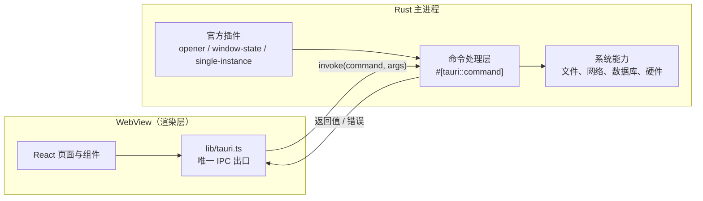

# 架构说明

## 一句话

Rust 负责"能做什么"，WebView 负责"长什么样"，两者只通过 `invoke` 与事件通信。

## 运行时结构



要点：

- WebView 里跑的是标准的 Web 应用，没有 Node 环境，碰不到文件系统。
- 所有系统能力必须先在 Rust 侧写成命令，再暴露给前端。
- 前端能调什么，由 `src-tauri/capabilities/default.json` 决定，默认拒绝。

## 前端分层

依赖方向是单向的，反过来就是设计出了问题：

```
pages/  →  components/  →  lib/  →  @tauri-apps/api
```

| 层            | 职责                            | 不该做的事                          |
| ------------- | ------------------------------- | ----------------------------------- |
| `pages/`      | 路由级编排、组合组件、调用 hook | 不写复杂业务逻辑，不直接调 `invoke` |
| `components/` | 可复用的展示与交互单元          | 不感知路由，不直接读全局状态        |
| `lib/`        | 能力封装：IPC、格式化、校验     | 不含 JSX                            |

**唯一例外**：`components/ui/` 是第三方生成的原子组件，不受上述约束。

**硬规则**：`pages/` 和 `components/` 里不允许出现 `import { invoke } from "@tauri-apps/api/core"`。
所有 IPC 调用收敛到 `lib/tauri.ts`。这样做有三个好处：

1. 换实现（比如接入 `tauri-specta` 生成类型）只改一个文件。
2. 写测试时可以整体 mock 掉。
3. 一眼能看出这个应用到底用了哪些系统能力。

## 通信机制

### 请求 / 响应（invoke）

前端调 Rust，等返回值。适合"取数据、执行动作"。

```ts
// lib/tauri.ts
export async function invokeGreet(name: string): Promise<string> {
  const { invoke } = await import("@tauri-apps/api/core");
  return invoke<string>("greet", { name });
}
```

注意：`invoke<T>` 的泛型**不做运行时校验**，它只是一个断言。跨进程边界的数据要当成不可信输入，必要时用 zod 校验。

### 事件（emit / listen）

Rust 主动通知前端，或窗口之间广播。适合"进度更新、后台任务完成、菜单点击"。
当前工程未使用，需要时：

```rust
app.emit("download-progress", 42)?;
```

```ts
import { listen } from "@tauri-apps/api/event";
const unlisten = await listen<number>("download-progress", (e) =>
  setProgress(e.payload),
);
```

`useEffect` 里注册监听必须返回 `unlisten`，否则组件卸载后仍会响应。

## 状态管理

按这个顺序升级，不要一上来就上库：

| 场景                                   | 方案                      | 现在有吗         |
| -------------------------------------- | ------------------------- | ---------------- |
| 单个组件内部                           | `useState` / `useReducer` | 有               |
| 兄弟组件共享                           | 状态提升到共同父级        | 有               |
| 跨页面 UI 状态（侧边栏折叠、当前项目） | Zustand                   | 未安装，需要时装 |
| 来自数据库/接口、需要缓存与失效        | TanStack Query            | 未安装           |
| 表单 + 校验                            | react-hook-form + zod     | 未安装           |

判断标准：**能靠组件树解决的就别引入全局状态**。全局状态每多一个，调试成本就多一分。

## 数据存储

| 数据                            | 存哪                         | 原因                                |
| ------------------------------- | ---------------------------- | ----------------------------------- |
| UI 偏好（主题、语言、窗口布局） | `localStorage`               | 不需要 Rust 参与，重启即恢复        |
| 业务数据                        | SQLite（`tauri-plugin-sql`） | 事务、索引、迁移，比 JSON 文件可靠  |
| 导出文件、缓存、日志            | `appDataDir`                 | 安装目录（Program Files）没有写权限 |
| 令牌、密钥                      | 系统钥匙串（`keyring` 插件） | 不落明文，不写进 localStorage       |

**绝对不要**把数据写到 exe 所在目录。Windows 下装在 `Program Files` 时是只读的，
开发机上能跑、装完就崩，这类问题排查成本极高。

获取路径：

```rust
let dir = app.path().app_data_dir()?; // 需要 tauri::Manager
```

## 安全边界

1. **能力白名单**：`src-tauri/capabilities/default.json`。加插件后前端报 "not allowed"，就是这里没加权限。
2. **CSP**：当前是 `null`（开发方便）。正式发布前必须配置，见 [安全规范](./security.md#csp)。
3. **不做动态代码执行**：不 `eval`，不加载远端 JS。
4. **外链隔离**：所有 http 链接由系统浏览器打开，不在 WebView 里导航。

## 目录职责速查

```
src/
  pages/            路由级页面，默认导出
  components/
    ui/             shadcn 原子组件（不改导出名）
    <domain>/       业务组件，按领域分目录
  lib/              纯 TS：IPC 封装、工具、校验
src-tauri/
  src/lib.rs        应用入口：插件注册、命令注册、启动逻辑
  src/main.rs       二进制入口，只调 lib.rs
  capabilities/     前端可调用接口白名单
  tauri.conf.json   窗口、打包、标识符
```

## 已知取舍

这些是有意为之，不是遗漏。改动前请先读 [ADR](./adr/README.md)。

| 取舍                               | 得到什么                 | 失去什么                                    |
| ---------------------------------- | ------------------------ | ------------------------------------------- |
| 用系统 WebView 而不是自带 Chromium | 安装包 1.4MB、内存低     | 三端渲染细节有差异，Linux 的 WebKitGTK 偏旧 |
| HashRouter 而不是 BrowserRouter    | 自定义协议下刷新不 404   | URL 里带 `#`，不好看                        |
| 不预装状态管理库                   | 起步轻，没有多余概念     | 跨页状态变多时需要补                        |
| 暂不接入 i18n                      | 文案直接写中文，改起来快 | 要出海时得整体抽一遍                        |
| `invoke` 泛型不做运行时校验        | 简单、零开销             | 后端返回结构变了前端不会立刻报错            |
