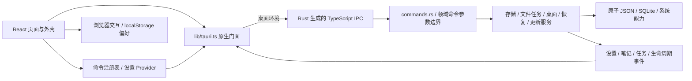

# 架构说明

本文说明当前运行入口、模块职责和数据边界。新增页面、命令或存储能力时，先复用已有入口；目录按实际职责拆分，不预建空的业务层。多人、多业务域场景的依赖方向、责任与设计门槛见 [规模化开发指南](./engineering-at-scale.md)，其中的演进示例不代表当前已实现。

## 运行时结构



前端由根 [`index.html`](../index.html) 加载 [`main.tsx`](../src/main.tsx)，挂载 App。App 组合设置、语言、主题、命令、未保存工作 Provider、全局 DemoMotion 与 HashRouter；RecoveryGate 确认原生存储状态后再挂载业务路由。[`AppShell`](../src/layouts/app-shell.tsx) 组合标题栏、分组侧栏、轻量位置提示与页面。原生由 [`main.rs`](../src-tauri/src/main.rs) 调用 [`lib.rs`](../src-tauri/src/lib.rs)，后者只组装插件、共享状态、命令和生命周期。

同一份 `src/` 支持桌面和浏览器两种运行环境。`pnpm app:dev` 启动 Rust 与 WebView，桌面构建通过 Tauri 自定义协议加载前端；`pnpm dev` 与在线演示在浏览器运行交互场景和外观设置，原生能力入口明确说明环境限制，实际系统调用仍由门面进行环境检查。

两种环境共用 HashRouter，路由位于 URL 片段中，页面刷新不要求静态托管服务解析应用路由。`pnpm build:web` 使用相对资源路径生成 `dist-web/`，适用于 GitHub Pages 项目子路径；桌面前端仍输出到 `dist/`。构建、预览和部署方法见 [浏览器演示](./development.md#浏览器演示构建与部署)，源码入口与交付目录见 [README](../README.md#从源码运行)。

## 模块职责

| 位置                                                          | 职责                                                               |
| ------------------------------------------------------------- | ------------------------------------------------------------------ |
| `src/routes.tsx`                                              | 懒加载页面、路径、导航分组、文案及演示页面标记                     |
| `src/config/app.ts` / `app.config.json`                       | 品牌、默认演示 / 精简模式、部署更新默认值                          |
| `src/commands/` / `providers/commands.tsx`                    | 命令描述、上下文可用性、菜单 / 面板 / 快捷键共用执行入口           |
| `src/components/`                                             | 交互与外壳；`ui/` 为 shadcn 原子组件                               |
| `src/components/showcase/` / `motion-lab/`                    | 交互场景与动效实验，页面内数据与播放状态                           |
| `src/features/`                                               | 已形成独立规则的能力目录、数据工作室、网络与媒体演示               |
| `src/components/workbench/`                                   | 文件草稿、预览与跨路由编辑状态                                     |
| `src/hooks/use-demo-motion.ts` / `components/demo-motion.tsx` | 文档可见性、场景离屏、用户偏好与全局 MotionConfig                  |
| `src/styles/`                                                 | 共用页面层次、导航与独立场景样式                                   |
| `src/providers/settings.tsx`                                  | 设置状态、保存反馈与生命周期                                       |
| `src/providers/unsaved-work.tsx`                              | 保留离页后的脏工作回调，协调保存、放弃与退出取消                   |
| `src/hooks/use-workspace.ts` / `use-task-notifications.ts`    | 工作区恢复、激活导航、任务通知及退出前等待 / 取消任务              |
| `src/lib/settings-model.ts` / `settings-sync.ts`              | schema 迁移、校验、局部字段合并、原生 revision 同步                |
| `src/lib/updates-store.ts`                                    | 每个 WebView 的更新状态、操作编号及进度快照协调                    |
| `src/hooks/use-native-resource.ts`                            | 原生页面数据加载、错误及过期请求结果隔离                           |
| `src/i18n/`                                                   | 类型化词典、语言注册表、系统匹配与翻译回退                         |
| `src/lib/tauri.ts`                                            | 系统能力的唯一前端门面；生成绑定是允许的底层例外                   |
| `src-tauri/src/commands.rs` / `*_commands.rs`                 | 基础及领域 IPC 参数边界与服务编排                                  |
| `src-tauri/src/bindings.rs`                                   | 命令 / DTO 导出注册；Rust 是 IPC 契约来源                          |
| `src-tauri/src/blocking.rs`                                   | 将同步存储、数据库与系统探测适配到阻塞任务池                       |
| `src-tauri/src/error.rs` / `redaction.rs`                     | 结构化错误与共用脱敏，不依赖诊断聚合或业务服务                     |
| `storage.rs` / `database.rs`                                  | 原子设置存储与 SQLite 迁移、事务、并发版本                         |
| `workbench.rs` / `workbench_commands.rs`                      | 原生路径授权、文件原子保存、扫描 / 哈希任务与持久历史              |
| `data_commands.rs`                                            | 分页笔记、草稿、批量操作与逻辑备份的命令入口                       |
| `extensions.rs` / `extension_commands.rs`                     | 扩展包、可选授权、来源与回退、2 个执行位 / 16 项有界队列及管理 IPC |
| `extension_execution.rs` / `extension_host.rs`                | 命令执行、类型化效果往返与 60 秒合作取消预算、存储与凭据服务编排   |
| `extension_network.rs` / `extension_storage.rs`               | 精确公网 / 本机网络 broker、系统凭据引用、按插件隔离的 KV CAS      |
| `extension_runtime.rs` / `extension_worker.rs`                | 固定无界面子进程、整体执行时限、新实例与编译 LRU                   |
| `extension_view.rs` / `extension_windows.rs`                  | 有界声明式视图、结果产物与可信本地宿主窗口                         |
| `extension_market.rs` / `extension_market_commands.rs`        | 固定官方源、目录签名 / 有效期、跨重启防回退、包完整性与来源收据    |
| `marketplace/`                                                | 独立 Git 子模块，维护市场插件源码、收录目录与签名发布流程          |
| `examples/extensions/`                                        | 使用官方 PDK 的 Rust / JS / TS 示例、内置 WAT 与固定上游互操作样例 |
| `lifecycle.rs` / `recovery.rs`                                | 跨窗口退出协商、启动存储隔离与重启恢复                             |
| `system_commands.rs`                                          | 工作区、激活参数、专用系统凭据与固定 worker 协议                   |
| `desktop.rs` / `autostart.rs`                                 | 窗口复用、托盘、后台行为与平台自启动                               |
| `window_geometry.rs`                                          | 按窗口保存逻辑尺寸，适配 DPI 与显示器工作区变化                    |
| `diagnostics.rs` / `updater.rs`                               | 诊断脱敏及更新策略、下载 / 安装状态                                |
| `resources/branding/` / `scripts/branding.mjs`                | SVG 设计源与平台图标、安装器位图的可复现生成                       |
| `scripts/fs-utils.mjs`                                        | 初始化与版本设置共用的路径校验、文件暂存、冲突检测与回滚           |

小领域继续放在现有页面、组件、Hook 和原生服务中；已有 `features/data-studio`、`network`、`media`、`catalog` 按实际规则内聚组件和模型，路由页面仍在 `pages/`。新增领域按 [业务模块与依赖方向](./engineering-at-scale.md#业务模块与依赖方向) 划分，不要求一次迁移全部页面，也不为消除几行相似代码增加空壳层。

纯数据契约、设置模型与迁移规则由 `i18n/`、`commands/` 和 `lib/` 各自维护；Provider 负责 React 上下文及生命周期。启动、错误恢复和纯逻辑模块直接依赖所属契约或模型，不通过 Provider 的重导出获取基础类型或函数。Rust 的错误模块与诊断服务共同使用基础脱敏模块，错误处理不反向依赖聚合诊断。

## 页面与演示边界

路由、导航分组与演示标记统一由 [routes.tsx](../src/routes.tsx) 维护。默认展示完整 demo；精简模式过滤 `demoOnly` 导航和命令，保留源码与依赖。各页工作流、来源文件和数据范围见 [模块指南](./demo-modules.md#体验现有模块)。

页面模块按需加载；侧栏悬停与键盘聚焦会预载对应模块，不提前挂载页面或执行 IPC。共享的 Suspense 边界在切页时保留已显示内容，待目标页模块就绪后切换；路由错误边界仍随导航重置。整页切换不再从透明状态播放入场动画，页面自身的演示动效仍按偏好运行。

外壳维护固定标题栏、可调宽侧栏、位置提示和独立内容滚动区；布局与焦点规则见 [界面规范](./conventions/ui-guidelines.md#布局常量)。设置页的搜索、失败重试与关于区遵循同一规范，不另建设置来源。

首页和能力目录通过 `features/journeys/` 提供交互、文件、任务、数据可靠性和扩展体验路线。导览用 URL 的 `journey` / `step` 参数表示当前位置，校验路线、步骤及页面是否匹配；只提供操作提示与导航，不执行操作、不推断任务完成，也不持久化流程状态。文件、任务与 CSV 步骤可下载样例，下载不自动替换数据。精简模式不推广已隐藏的交互路线。

展厅风格先局部预览，应用后才写入偏好，撤销恢复本轮首次应用前的外观。组件页的表单、协作者、通知、收藏与工作区状态属于页面内演示；工作区树、拖放、菜单和编辑不访问磁盘。同页切换保留输入，离页或重载不承诺恢复。数据工作室的记录 / 表单、媒体页的内容 / 图表 / 连接按标签分区；图表与连接区首次访问时挂载，同页切换保留状态，离页清理连接与附件资源。数据工作室不写 SQLite，网络 fixture 与限时会话不代表远程账户；媒体附件不上传，外部 WSS 可能不可用。

动效由 DemoMotion / useDemoMotion 协调应用偏好、系统减少动效、文档可见性与实际画布离屏状态；CSS 与命令式循环仍需显式暂停和清理。播放边界见 [动效规范](./conventions/ui-guidelines.md#动效)。

CSV 导入通过 `features/data-studio/csv.ts` 有界解析、字段映射和逐行校验，明确确认部分导入后才替换页面临时记录；不写笔记数据库。导入数据登记未保存工作，完整导出确认后才清除脏状态，筛选导出或取消仍保留。字段、额度与操作见 [模块指南](./demo-modules.md#数据工作流与冲突比较)。

文件与笔记冲突共用 `TextDiff` 和有面积上限的行差异算法。每块默认本地，合并只更新编辑器和已审阅的远端 revision / version；后续保存仍由原服务执行条件写入，新冲突保留草稿。大文本只缩短预览，不截断实际合并内容。

Wasm 扩展采用包格式 3 / API 2。清单按命令贡献输入、结果、能力门槛和侧栏 / 窗口入口，必需与可选能力在插件级授权；命令复用 CommandsProvider。文本工具主动提交数据，视图初始化与按钮调用使用同一执行入口；插件可返回有界 HTTP / KV 效果，宿主校验后以结构化结果再次调用插件，不执行网页代码。通用渲染器支持表单、字段错误、图表、分页表格、内嵌图片与用户确认保存的产物，页面和独立窗口共享组件。

ExtensionsProvider 汇集快照、每窗口会话和动态入口；原生端按窗口串行、最多 2 项执行与 16 项排队。固定当前应用的无界面 worker 在 Tauri 初始化前分派，每次创建新 Wasm 实例，复用有界编译 LRU；15 秒 worker 时限覆盖编译，完整效果编排另有 60 秒合作取消预算，排队不计入，同步操作系统 I/O 不能硬性限时；取消后持有租约到实际工作结束。安装记录的 generation 在安装 / 替换 / 回退时更换，启用 / 授权调整保留，身份相关 IPC 同时核对模块哈希和 generation，防止旧管理请求影响新身份。独立注册表、私有 KV、凭据别名和市场信任各自有数据边界，不并入设置或笔记 schema。协议、开发态不兼容处理、线上市场待发布与验收边界统一见 [扩展指南](./extensions.md)。

原生能力页使用 NativePage 说明浏览器限制并展示当前页面的操作流程，不生成原生结果；通信页保留表单与代码，实际提交仍由门面检查。两者都不伪造 IPC 成功。

## 命令与桌面交互

菜单、命令面板和快捷键通过同一命令注册 / 执行入口调用。命令的可用性取决于当前路由、演示模式与原生环境；浏览器预览不会执行原生操作。快捷键匹配集中处理 Cmd / Ctrl、输入框、输入法组合输入、重复按键和冲突，避免各组件分别监听全局按键。

`features/content-search/` 在命令面板打开且输入至少 2 字时，以有界、防抖请求查询笔记标题 / 正文和已授权最近文件名，每类最多 8 项；不扫描整个磁盘。结果注册为既有命令，通过资源 ID 或笔记 ID 导航；目的页重新加载并保留既有脏编辑确认，过期检索不覆盖新请求。浏览器只检索命令，不构造原生内容结果。

设置搜索索引指向稳定的控件锚点，命令面板可导航并聚焦对应设置。侧栏折叠、宽度和模式进入同一设置模型；路由表中的 `demoOnly` 控制演示页可见性，精简模式不删除源码。

主 / 次窗口标签固定为 `main` 和 `secondary`，再次打开次窗口会显示并聚焦已有实例；扩展独立窗口使用宿主生成的 `extension-*` 标签，入口和会话边界见 [扩展指南](./extensions.md#开发带界面的应用插件)。桌面状态在 Builder 上提前注册，单实例插件最先初始化；重复启动回调只合并唤醒请求并投递后台任务，不同步等待窗口创建或显示。窗口共用原生设置，各自保留渲染状态；主 / 次窗口共用笔记数据库。

主窗口配置 `create: false`，由 setup 在设置、数据库和共享状态就绪后从阻塞任务池创建，避免 WebView 创建占住启动事件循环，也防止页面访问尚未注册的状态。窗口初始隐藏，前端两次动画帧回调后通过 `complete_frontend_startup` 握手显示；首帧完成前的重复唤醒不强制显示空白内容。Rust 在窗口创建成功后安排三秒显示兜底，关闭或销毁时取消，且不恢复用户已最小化的窗口。兜底显示不代表前端已正确渲染，启动阶段日志的含义见 [启动排障](./troubleshooting.md#启动慢或重复启动后卡死)。

该握手由 App 层的 [`useRevealWindow`](../src/hooks/use-reveal-window.ts) 发出，不等待懒加载页面或首批数据请求完成；窗口可能先显示外壳与加载占位。它是显示时机信号，不能作为页面内容就绪或到可交互时间的验收证据。

窗口状态插件恢复上次位置和显示状态，排除尺寸、装饰与可见性。尺寸由几何模块统一维护，平台配置决定装饰，首帧握手决定显示时机。持久偏好 `windowPosition` 控制新建窗口的初始位置：默认 `remember` 沿用位置恢复，`center` 请求启动居中；切换策略不移动当前窗口，重复激活已有窗口也不重新定位。macOS 用平台配置保留系统红绿灯；平台配置的 `app.windows` 数组整体替换，`create: false` 等生命周期字段需同步。

窗口状态插件之后运行几何适配插件，按窗口保存逻辑尺寸，并监听 DPI、窗口事件及显示器布局；在远程桌面或工作区变化后约束到可用范围。窗口就绪回调只记录初始策略与修正任务，不在持有插件锁的回调中同步改动几何，避免 Windows 消息重入导致死锁；几何存档写盘由后台 worker 处理。运行期间普通移动不持续吸附屏幕边缘，临时缩小保留首选尺寸，最大化 / 全屏 / 最小化时不主动修改位置。迁移限制与诊断步骤见 [排障手册](./troubleshooting.md#远程桌面断开后窗口过大或落在屏幕外)。

设置页提供常用窗口尺寸预设，以逻辑像素（DIP）标注宽高；选择后立即应用到当前窗口并记忆，超过窗口配置或当前工作区范围的预设不可选。手动拖动仍可产生其他尺寸，界面显示实际值，不强制匹配某个预设。最大化、最小化或全屏窗口应用尺寸前先还原。尺寸修改在主线程执行，命令在工作线程等待并完成原子写盘后才返回。`window-geometry.json` 是尺寸的权威存档，旧窗口状态中的物理尺寸仅用于首次迁移，避免双重恢复覆盖用户设定。

新窗口创建时捕获最后已保存的启动位置策略和可用的最近正常位置。位置记录在进程启动时读取窗口状态存档，之后由正常移动更新内存，次窗口重建使用最新记录；初始位置来源在复核期间保持固定，按当前工作区约束，避免异步请求后的旧坐标覆盖恢复目标。居中以该位置选择显示器，优先取重叠面积最大的有效工作区，原显示器断开时取最近的有效工作区；保留记忆的逻辑尺寸，并扣除原生边框。创建返回后、首帧握手显示前和超时显示前共用初始布局入口，显示前准备，窗口可见后有限复核实际尺寸、外框与位置；确认完成或达到上限后结束初始定位，不阻塞显示或持续回中。启动居中先调整正常位置，再恢复原显示状态；异步还原未完成时保留原状态并放弃本次居中。后续拖动与再次唤醒不重复执行初始定位。

默认正常关闭窗口；主 / 次窗口在启用后台运行且托盘可用时，关闭请求改为隐藏，扩展独立窗口仍正常关闭。关闭、托盘退出、明确退出、重启和安装更新共用 `lifecycle.rs`：收集相关窗口的脏工作，保存 / 放弃成功后继续，失败或取消则保留窗口。同一时间只允许一项生命周期操作，占用持续到协商和实际执行结束；没有脏工作也不能绕过正在执行的操作，取消、失败或异步任务结束后释放占用。窗口创建与生命周期操作互斥，避免新窗口越过协商快照；创建过程不持有状态锁。系统退出先预留同一边界，确认退出后拒绝新窗口；若已有窗口正在创建，则等待完成后再判断是否需要退出。窗口批准关闭后拒绝其晚到的扩展调用，等待已有执行停止后销毁；同标识窗口重建也不会恢复旧请求。

`UnsavedWorkProvider` 保留离页后的保存回调；后台任务由主窗口登记，保存表示等待完成，放弃表示合作取消并等待 worker 退出。取消等待不能撤销已经落盘或已取消的工作。浏览器保留 `beforeunload` 提醒，不声称能控制所有外部关闭方式。

工作区仅为主 / 次窗口保存路由表中非隐藏的静态页面与次窗口打开状态；动态扩展会话路径不写入工作区恢复存档。原生激活按接收顺序编号，保留最新 20 条已完成结果。文件关联接收原生路径，以及经已有深链插件转交的本地 `file:` URL（如 macOS Finder）；URL 通过标准路径解码，拒绝远端主机、凭据、查询参数和片段。文件关联在阻塞任务池完成路径授权和文档读取验证后，将资源 ID、文件名与错误存入激活快照并发布同一事件，不缓存文档正文，也不重复发送拖入事件。最多接收 32 个参数、处理其中 20 个关联文件，最多允许 20 个文件激活请求在途；超额请求返回可见错误，窗口创建和唤醒不等待读取。

主窗口在全局先订阅激活事件、再读快照，以激活 ID 去重，通过既有文件加载 IPC 打开已授权资源；因此冷启动或切换页面时不依赖工作台已经挂载。完成顺序可不同于接收顺序，快照按 ID 排序，较晚完成的旧请求不覆盖较新的导航或文档选择；打开已有文档时保留未保存草稿。文件打开失败仍进入工作台展示错误。资源授权沿用最近 100 项缓存；大量后续授权使旧激活 ID 对应资源被淘汰时，加载明确提示重新选择，不把历史快照当成永久文件授权。

前端编辑器最多接收 20 次激活读取，每次按资源顺序加载；达到上限时保留在途操作，并提示稍后重新打开文件。去重保留全部在途操作和 ID 最大的 20 条已完成文件交接，纯导航不创建文件任务。用户在读取期间保存、关闭或重新打开同一资源，会使旧读取结果失效；页面离开和 StrictMode 重建不丢失已接收的文件交接。文件打开错误保留最近 20 项，跨页可见并由用户清除。

深链 scheme 和文件扩展名由 [`app.config.json`](../app.config.json) 的 `integration` 定义，初始化脚本同步安装关联，Rust 解析与前端示例复用同一配置。模板默认示例为 `tdemo://open?route=...` 和 `.tdemo`；深链仅导航允许的本地路由，应用专属扩展名的文件按 UTF-8 JSON 通过同一原生文件授权入口读取。系统快捷键只允许预定义组合。自启动由用户主动开关，测试构建禁止系统自启动与凭据操作；关联、深链、通知等仍需目标平台的安装版验收。

## 通信机制

Rust `tauri-specta` 从命令与 DTO 生成 [`src/lib/generated/bindings.ts`](../src/lib/generated/bindings.ts)。开发者实现命令、添加 `#[specta::specta]` 并在 `bindings.rs` 注册，然后运行：

```bash
pnpm bindings:generate
pnpm bindings:check
```

页面和 Hook 只依赖 `lib/tauri.ts`；门面加载生成的 `commands` 并归一化成功 / 失败。不要手改生成文件、在页面拼命令字符串，或额外维护一套返回 DTO。

命令返回 `NativeResult<T>`，错误统一包含 `code`、`message`、`retryable`。前端按稳定 code 决定文案和行为，不解析错误文本，也不对对象直接 `String(error)`。生成类型检查源码契约，不能替代 Rust 入参校验、数据大小限制与路径边界。

事件通过门面订阅：设置与任务事件携带 revision 快照，笔记事件通知重新查询，更新事件携带 operationId 与阶段进度，退出协商使用独立请求 ID。设置、任务、更新与工作区恢复先订阅、再读快照，并按修订号、操作阶段或期间已处理的导航过滤旧消息；不要假设事件与命令返回存在跨窗口的统一到达顺序。订阅异步返回取消函数；组件卸载、StrictMode 重建或注册晚到时都必须取消，晚到回调也要检查所属订阅是否失效。事件不构成持久消息队列，数据写入结果仍以命令返回为准。

门面的业务事件监听显式使用当前 `WebviewWindow` 目标，原生 `emit_to(label, ...)` 才能只交给该窗口；Tauri 全局 `listen` 的默认目标是 `Any`，会接收发给其他窗口的事件，循环定向发送可能因此重复到达。设置、任务与协商完成等 `app.emit` 广播仍会匹配窗口目标。目标限定不替代卸载释放与失效回调检查。

## 状态管理与设置迁移

组件局部状态使用 React 状态；跨页偏好由 SettingsProvider 管理，命令上下文由 CommandsProvider 管理。文件编辑使用当前 WebView 的外部 store 保留跨路由草稿；未保存工作登记在全局 Provider。TanStack Query 与 React Hook Form 只服务于对应领域示例，不替代原生设置、数据库或任务服务的权威状态。

设置文档的版本由 [`settings-model.ts`](../src/lib/settings-model.ts) 维护，当前为 schema 3：

- 读取旧版无版本扁平存档、schema 1 包装结构和 schema 2，保留主题、外观与布局字段。
- 未提供主题时读取当前应用命名空间内的主题缓存；仅原模板命名空间兼容旧通用 `theme` 存储键，避免派生应用继承其他站点偏好。旧纹理背景映射到现有 SVG 插画。
- 字段按白名单规范化；侧栏宽度限制在支持范围，未知字段不写回。
- 未来 schema 显示不兼容错误并阻止自动覆盖；明确重置后才允许替换。
- 首次语言按系统偏好匹配 zh / en，已保存选择优先；重置保留用户语言。
- 启动位置策略 `windowPosition` 支持 `remember` / `center`；旧存档缺少该字段时使用 `remember`。
- `customBackground` 保存当前选中图片的自包含副本、名称与填充方式。切换内置皮肤保留选择，取消图片背景或重置偏好时清除该副本，但不删除图库；缺少合法图片的自定义背景回落到纯色。独立图库、图片预算、兼容与失败语义见 [ADR 0004](./adr/0004-wallpaper-library.md)。

恢复默认设置会重置偏好，以及所有已打开窗口和已记忆窗口的尺寸；默认尺寸取各窗口配置，并约束到可用工作区。启动位置策略恢复为 `remember`，保留当前窗口位置，屏外位置仍经过必要的可见性修正。尺寸恢复与偏好保存依次完成，分别具有独立持久化边界；任一步失败均保留确认框及错误，允许重试，不显示完成提示。

原生设置是权威快照，存于配置目录的 `settings.json`，采用原子替换和 revision compare-and-swap。前端设置模型负责字段迁移与未来 schema 保护；Rust 校验 JSON 结构、大小、深度和原生使用的字段。SettingsSync 将未提交字段与在途修改分开合并，冲突后读取新快照并有限重试；保存失败保留用户修改，界面提供状态和重试。跨窗口事件只接受新的 revision，不能让旧事件覆盖新状态。

浏览器模式使用当前站点的 localStorage 保存偏好，交互场景的数据按各页面的生命周期维护；在线演示不具备原生 SQLite、系统窗口或更新安装能力。原生模式保留本地缓存用于初始渲染与旧设置迁移，成功保存仍以原生快照为准。主题也纳入同一模型，避免 next-themes 与多窗口分别保存出两份事实。

`app.config.json` 的 `browserStorageNamespace` 统一隔离设置键、next-themes 主题缓存、图库 IndexedDB 和广播通道，避免同源不同子路径的派生演示串用数据。当前模板保留 `tauri-starter`，已有设置和图库无需搬迁；初始化脚本在应用标识变更时默认使用新 `identifier`，也支持显式配置，见 [项目初始化](./development.md#项目初始化)。切换命名空间不会删除或自动导入旧数据；它区分应用数据，不构成同源脚本之间的安全隔离。

## 数据存储

| 数据           | 位置与边界                                                                                                                                                                                                 |
| -------------- | ---------------------------------------------------------------------------------------------------------------------------------------------------------------------------------------------------------- |
| 设置、窗口存档 | Tauri `appConfigDir`；可恢复的损坏设置先备份再恢复，前端对未来设置 schema 阻止自动写回                                                                                                                     |
| 笔记数据库     | `appDataDir/starter.sqlite3`，由 Rust `rusqlite` 持有连接                                                                                                                                                  |
| 笔记备份       | `appDataDir/backups/` 下的版本化逻辑 JSON，包含全部笔记、回收站及窗口草稿                                                                                                                                  |
| 文件与任务     | 用户明确授权的外部文件；授权记录、任务历史及报告在 `appDataDir/workbench/`                                                                                                                                 |
| 壁纸图库       | 桌面 `appDataDir/wallpapers.json`，Rust 服务原子更新；浏览器演示使用独立 IndexedDB。图库不属于笔记数据库备份范围，恢复隔离模式使用临时图库                                                                 |
| 扩展安装       | `appDataDir/extensions/` 保存注册表和模块，`extension-data/` 保存私有 KV / 凭据别名，`extension-market/` 保存目录防回退信任；均不属于笔记备份或恢复归档，见 [扩展指南](./extensions.md#执行存储与生命周期) |
| 应用日志       | `appLogDir`，轮换规则见 [排障手册](./troubleshooting.md#先看日志)                                                                                                                                          |
| 浏览器缓存     | WebView / 浏览器的 localStorage，仅存非敏感偏好                                                                                                                                                            |
| 用户凭据       | `keyring` 保存应用演示项与按插件 / origin / 别名隔离的扩展凭据；JSON 只存别名元数据，不存秘密                                                                                                              |

原生设置在文件可读取、未超过读取大小上限但内容无效时，保留 `settings-corrupt-*.json` 备份后恢复空快照。读取失败、文件超限或备份失败会返回错误；启动恢复入口接管这些错误并隔离业务状态，不强行覆盖原文件。浏览器 localStorage 的读取或 JSON 解析失败时以默认值维持界面、保留原存档，期间修改只留在内存；重试须先成功读取，再合并期间明确修改过的字段并保存，明确重置才允许直接替换。浏览器没有原生文件备份机制，未来 schema 同样阻止自动写回。

SQLite 用 `PRAGMA user_version` 标记数据库 schema，当前为 2，迁移在事务中完成；遇到未来数据库版本拒绝修改。查询支持搜索、排序、分页和回收站，单页最多 100 条。更新与批量回收 / 恢复 / 永久删除检查 `expectedVersion`，整批事务遇到冲突全部回滚；旧兼容删除命令仍仅按 ID 执行，新界面使用版本化批量入口。不向前端暴露任意 SQL、数据库路径或文件系统权限。

笔记草稿按窗口标签持久化在 SQLite；读取完成前暂停编辑和备份写入，失败可重读。保存正式笔记和放弃草稿各有独立动作，并参加退出协商。逻辑备份包含全部笔记、回收站和草稿，JSON 上限 16MiB，超限明确拒绝；恢复先验证格式、schema、ID 与数据，再保存当前完整安全备份并事务替换，重新分配版本以拒绝旧编辑。恢复后的草稿读取失败只重试读取，不重复恢复数据库。备份不包含凭据、应用设置、日志或外部工作台文件，也不提供云端恢复。

文件工作台仅接受原生选择、文件关联或拖入授权；IPC 后续使用资源 ID。文本上限 2MiB、图片 8MiB，图片只读；JSON 与配置的应用专属扩展名文档保存前校验，Markdown 不执行 HTML。编辑先写同目录临时文件，比较原内容 SHA-256 后原子替换，外部修改冲突保留草稿并提供查看磁盘版本 / 另存副本。该检查不是跨进程共享锁，不能宣称消除了最终检查与替换之间的全部竞态。

扫描与 SHA-256 在 Rust 阻塞任务池运行，最多 2 项执行、10 项 FIFO 排队；排队可直接取消，运行任务合作取消后释放执行位置。离页或隐藏窗口不停止任务；重启后未完成项标记 `interrupted`，用户可重试，没有断点续传。最近保留 30 项，界面预览 200 条结果，完整报告可导出；入队历史保存失败时保留已有报告。扫描因文件数或目录深度限制未能完整遍历时标记结果截断；扫描与哈希的文件数、深度和单文件限制以 `workbench.rs` 常量为准。

数据目录由 Tauri 路径 API 决定，不写入 exe 所在目录。恢复默认设置更新偏好与窗口尺寸存档，不删除笔记、日志或 WebView 数据。测试 feature 使用独立用户目录，见 [E2E 隔离](./testing.md#真实桌面-e2e)。

## 恢复、诊断与更新

App 外层错误边界处理根渲染失败；路由内的恢复边界保留外壳和导航，可重试当前页面。加载、保存和删除失败应保留输入及已有数据，并提供明确下一步。

启动设置 / 数据库打开失败时，`recovery.rs` 建立临时设置、数据库和工作台，RecoveryGate 限定恢复与诊断入口，临时数据不覆盖正式存档。用户可预览并恢复受控备份，明确确认后暂存待替换文件；下次启动在正式连接打开前归档原数据库、WAL / SHM 与可选设置，再按恢复日志安装，失败回滚并保留归档。待恢复设置先做只读校验，损坏候选须拒绝并保留，不能按启动默认恢复流程重置后安装；未来数据库或设置版本仍拒绝降级覆盖。目录不可写等故障也可能使恢复操作失败，界面需保留原因与原件；恢复能力不等于已经完成所有目标平台的故障演练。

诊断报告包含应用 / Tauri / 平台信息、窗口、设置 revision、数据库版本、桌面状态和有限日志。记录前端异常有速率限制，预览日志会脱敏；复制或反馈前仍需人工复核，不把完整设置、笔记或环境变量作为诊断内容。

更新由 Rust 持有检查结果和安装句柄，前端订阅状态 / 进度，以及检查时间和有效端点。默认 GitHub 地址与公钥来自品牌配置，公钥为空时禁用且不请求网络；主窗口的启动检查偏好由设置模型持久化，后台提醒不触发下载或安装。配置、超时、签名顺序及部署覆盖见 [自动更新](./build-release.md#自动更新)。更新不能用前端任意 URL 绕开固定策略，也不允许跳过签名验证。

下载验签结束后、实际安装前再协商各窗口，避免下载期间新建的草稿被跳过；安装阶段保持窗口协商界面，失败或取消解除等待。是否具备可发布签名及安装升级验收证据，仍以发布配置和实际验证记录为准。

## 安全边界

核心与插件权限在 [`capabilities/default.json`](../src-tauri/capabilities/default.json) 和 [`capabilities/extensions.json`](../src-tauri/capabilities/extensions.json) 中按窗口分配；自定义命令的应用 ACL 与插件 capability 是不同机制，详见 [能力最小化](./security.md#能力最小化)。当前主 / 次窗口与扩展宿主窗口均为可信本地界面，不在其 WebView 中加载第三方网页。

桌面构建的 CSP 限制脚本和网络来源，外链统一交给系统浏览器。数据库、设置、更新和自启动由限定服务负责；新增页面不因此获得通用文件、Shell 或 SQL 能力。浏览器演示遵循浏览器权限与同源存储边界，不包含可调用的 Rust 进程。

## 扩展原则

技术选型与协作决策见 [ADR](./adr/README.md)。扩展前先确认实际需要：新增语言复用 locale 注册表，新增操作复用命令注册表，新增原生能力复用生成绑定与门面。跨模块、数据兼容或发布行为的变更先完成 [设计影响分析](./engineering-at-scale.md#设计评审与-adr-门槛)。当前桌面配置不包含移动端交付，新增平台、远程内容或敏感数据存储都需要单独设计和验证。
