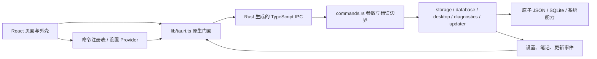

# 架构说明

本文说明运行入口、模块职责和数据边界。新增页面、命令或存储能力时，先复用已有入口；目录按实际职责拆分，不预建空的业务层。

## 运行时结构



前端由根 [`index.html`](../index.html) 加载 [`main.tsx`](../src/main.tsx)，挂载 App。App 组合设置、语言、主题、命令 Provider 和 HashRouter；AppShell 组合标题栏、侧栏与页面。原生由 [`main.rs`](../src-tauri/src/main.rs) 调用 [`lib.rs`](../src-tauri/src/lib.rs)，后者只组装插件、共享状态、命令和生命周期。

`pnpm dev` 只有浏览器界面；`pnpm app:dev` 同时启动 Rust 与 WebView。生产前端使用 Tauri 自定义协议和 HashRouter。源码入口、中间产物与交付目录见 [README](../README.md#从源码运行)。

## 模块职责

| 位置                                             | 职责                                                     |
| ------------------------------------------------ | -------------------------------------------------------- |
| `src/routes.tsx`                                 | 懒加载页面、路径、导航文案及演示页面标记                 |
| `src/config/app.ts` / `app.config.json`          | 品牌、默认演示 / 精简模式、部署更新默认值                |
| `src/commands/` / `providers/commands.tsx`       | 命令描述、上下文可用性、菜单 / 面板 / 快捷键共用执行入口 |
| `src/components/`                                | 交互与外壳；`ui/` 为 shadcn 原子组件                     |
| `src/providers/settings.tsx`                     | 设置状态、保存反馈与生命周期                             |
| `src/lib/settings-model.ts` / `settings-sync.ts` | schema 迁移、校验、局部字段合并、原生 revision 同步      |
| `src/i18n/`                                      | 类型化词典、语言注册表、系统匹配与翻译回退               |
| `src/lib/tauri.ts`                               | 系统能力的唯一前端门面；生成绑定是允许的底层例外         |
| `src-tauri/src/commands.rs`                      | IPC 参数边界与服务编排                                   |
| `src-tauri/src/bindings.rs`                      | 命令 / DTO 导出注册；Rust 是 IPC 契约来源                |
| `storage.rs` / `database.rs`                     | 原子设置存储与 SQLite 迁移、事务、并发版本               |
| `desktop.rs`                                     | 窗口复用、托盘、后台行为与自启动                         |
| `window_geometry.rs`                             | 按窗口保存逻辑尺寸，适配 DPI 与显示器工作区变化          |
| `diagnostics.rs` / `updater.rs`                  | 诊断脱敏及更新策略、下载 / 安装状态                      |
| `resources/branding/` / `scripts/branding.mjs`   | SVG 设计源与平台图标、安装器位图的可复现生成             |

小领域继续放在现有页面、组件、Hook 和原生服务中；同一业务领域需要独立维护一组页面、数据与组件时，再引入 `features/<domain>/`。不要为消除几行相似代码增加空壳层。

## 命令与桌面交互

菜单、命令面板和快捷键通过同一命令注册 / 执行入口调用。命令的可用性取决于当前路由、演示模式与原生环境；浏览器预览不会执行原生操作。快捷键匹配集中处理 Cmd / Ctrl、输入框、输入法组合输入、重复按键和冲突，避免各组件分别监听全局按键。

设置搜索索引指向稳定的控件锚点，命令面板可导航并聚焦对应设置。侧栏折叠、宽度和模式进入同一设置模型；路由表中的 `demoOnly` 控制演示页可见性，精简模式不删除源码。

窗口标签固定为 `main` 和 `secondary`，再次打开次窗口会显示并聚焦已有实例。单实例插件最先注册；重复启动恢复主窗口。两个窗口共用原生设置和数据库，而各自保留渲染状态。

窗口先隐藏，前端首帧后显示；Rust 为主 / 新建窗口提供兜底。位置恢复排除装饰与可见性，避免提前显示或覆盖平台装饰。macOS 用平台配置保留系统红绿灯；平台配置的 `app.windows` 数组整体替换，新增字段需同步。

窗口状态插件之后运行几何适配插件，按窗口保存逻辑尺寸，并监听 DPI、窗口事件及显示器布局；在远程桌面或工作区变化后约束到可用范围。普通移动不持续吸附屏幕边缘，临时缩小保留首选尺寸，最大化 / 全屏 / 最小化不改位置。迁移限制与诊断步骤见 [排障手册](./troubleshooting.md#远程桌面断开后窗口过大或落在屏幕外)。

默认正常关闭窗口；启用后台运行且托盘可用时，关闭请求改为隐藏。明确的「退出」调用 `quit_app` 结束应用。自启动由用户主动开关，测试构建禁止读写系统自启动项。

## 通信机制

Rust `tauri-specta` 从命令与 DTO 生成 [`src/lib/generated/bindings.ts`](../src/lib/generated/bindings.ts)。开发者实现命令、添加 `#[specta::specta]` 并在 `bindings.rs` 注册，然后运行：

```bash
pnpm bindings:generate
pnpm bindings:check
```

页面和 Hook 只依赖 `lib/tauri.ts`；门面加载生成的 `commands` 并归一化成功 / 失败。不要手改生成文件、在页面拼命令字符串，或额外维护一套返回 DTO。

命令返回 `NativeResult<T>`，错误统一包含 `code`、`message`、`retryable`。前端按稳定 code 决定文案和行为，不解析错误文本，也不对对象直接 `String(error)`。生成类型检查源码契约，不能替代 Rust 入参校验、数据大小限制与路径边界。

事件通过门面订阅：设置快照、笔记变更和更新进度各有明确语义。订阅异步返回取消函数；组件卸载、StrictMode 重建或注册晚到时都必须取消，不能把 Promise 当 cleanup。事件用于通知失效与刷新，写入结果仍以命令返回为准。

## 状态管理与设置迁移

组件局部状态使用 React 状态；跨页偏好由 SettingsProvider 管理，命令上下文由 CommandsProvider 管理。当前没有引入 Zustand、TanStack Query 或通用表单状态库。

设置文档的版本由 [`settings-model.ts`](../src/lib/settings-model.ts) 维护，当前为 schema 2：

- 读取旧版无版本扁平存档和 schema 1 包装结构，迁移主题、外观与布局字段。
- 未提供主题时兼容旧 `theme` 存储键；旧纹理背景映射到现有 SVG 插画。
- 字段按白名单规范化；侧栏宽度限制在支持范围，未知字段不写回。
- 未来 schema 显示不兼容错误并阻止自动覆盖；明确重置后才允许替换。
- 首次语言按系统偏好匹配 zh / en，已保存选择优先；重置保留用户语言。

原生设置是权威快照，存于配置目录的 `settings.json`，采用原子替换和 revision compare-and-swap。SettingsSync 将未提交字段与在途修改分开合并，冲突后读取新快照并有限重试；保存失败保留用户修改，界面提供状态和重试。跨窗口事件只接受新的 revision，不能让旧事件覆盖新状态。

浏览器模式使用 localStorage；原生模式保留本地缓存用于初始渲染与旧设置迁移，成功保存仍以原生快照为准。主题也纳入同一模型，避免 next-themes 与多窗口分别保存出两份事实。

## 数据存储

| 数据           | 位置与边界                                                              |
| -------------- | ----------------------------------------------------------------------- |
| 设置、窗口存档 | Tauri `appConfigDir`；设置损坏时备份后恢复，未来版本不覆盖              |
| 笔记数据库     | `appDataDir/starter.sqlite3`，由 Rust `rusqlite` 持有连接               |
| 应用日志       | `appLogDir`，轮换规则见 [排障手册](./troubleshooting.md#先看日志)       |
| 浏览器缓存     | WebView / 浏览器的 localStorage，仅存非敏感偏好                         |
| 用户凭据       | 当前未接入；需要时使用系统钥匙串，不存明文 JSON / SQLite / localStorage |

SQLite 用 `PRAGMA user_version` 标记数据库 schema，迁移在事务中完成；遇到未来数据库版本拒绝修改。笔记查询参数化，更新检查 `expectedVersion`，冲突要求重新加载；不向前端暴露任意 SQL、数据库路径或文件系统权限。

笔记草稿仅保留在当前 WebView 内存，支持跨路由返回；点击保存成功后才进入数据库。关闭窗口、退出进程或更新重启前需先保存；浏览器 `beforeunload` 提示不能覆盖 Tauri 原生关闭、托盘退出等路径，当前没有跨原生退出的草稿保存协调协议。

数据目录由 Tauri 路径 API 决定，不写入 exe 所在目录。重置偏好不删除笔记、日志、窗口存档或 WebView 数据。测试 feature 使用独立用户目录，见 [E2E 隔离](./testing.md#真实桌面-e2e)。

## 恢复、诊断与更新

App 外层错误边界处理根渲染失败；路由内的恢复边界保留外壳和导航，可重试当前页面。加载、保存和删除失败应保留输入及已有数据，并提供明确下一步。

诊断报告包含应用 / Tauri / 平台信息、窗口、设置 revision、数据库版本、桌面状态和有限日志。记录前端异常有速率限制，预览日志会脱敏；复制或反馈前仍需人工复核，不把完整设置、笔记或环境变量作为诊断内容。

更新由 Rust 持有检查结果和安装句柄，前端订阅状态 / 进度。默认 GitHub 地址来自品牌配置，公钥为空时禁用且不请求网络。配置、签名顺序及部署覆盖见 [自动更新](./build-release.md#自动更新)。更新不能用前端任意 URL 绕开固定策略，也不允许跳过签名验证。

## 安全边界

核心与插件权限在 [`capabilities/default.json`](../src-tauri/capabilities/default.json) 中分配；自定义命令的应用 ACL 与插件 capability 是不同机制，详见 [能力最小化](./security.md#能力最小化)。当前主 / 次窗口均为可信本地界面，不在其 WebView 中加载第三方网页。

生产 CSP 限制脚本和网络来源，外链统一交给系统浏览器。数据库、设置、更新和自启动由限定服务负责；新增页面不因此获得通用文件、Shell 或 SQL 能力。

## 参考与扩展

参考核对了说明与具体源码，仅借鉴职责和交互，不复制素材或整套权限：

| 参考源码                                                                                                                                                                                                                                                                                       | 可取之处与当前边界                                                                     |
| ---------------------------------------------------------------------------------------------------------------------------------------------------------------------------------------------------------------------------------------------------------------------------------------------- | -------------------------------------------------------------------------------------- |
| [pehcst 语言注册表](https://github.com/pehcst/tauri-template-react/blob/9fb91958a6624e4708f961ff8b1ea7f531f50ae0/src/i18n/locales.ts)                                                                                                                                                          | 类型化 locale 与用户偏好优先；目前只维护中英，复杂 ICU / 远程词典仍需按需求评估        |
| [mihasm 命令快捷键](https://github.com/mihasm/tauri-desktop-template/blob/378cb803ae8ce211c24bf7e28a08d0c7ac4b07c4/src/lib/shortcuts.ts)                                                                                                                                                       | 集中命令描述；本项目另外处理输入框、IME 和路由可用性，不引入后台全局热键权限           |
| [somus 绑定导出入口](https://github.com/somus/create-tauri-react-app/blob/117a2a3d38e7fe1b4344cbf5ef9bc8817e956c57/src-tauri/src/bin/generate_bindings.rs)                                                                                                                                     | Rust 生成 IPC；本项目已有独立导出与 CI 漂移检查，运行时边界仍由 Rust 校验              |
| [dannysmith 命令注册表](https://github.com/dannysmith/tauri-template/blob/437a18b9b63924833857f299217a5270f009d120/src/lib/commands/registry.ts) / [TASK 诊断](https://github.com/ItsCodejac/tauri-app-starter-kit/blob/e4ca6e67eba8517011905ad531c9a3f4712cb5f9/src-tauri/src/diagnostics.rs) | 统一入口与可复制诊断；当前诊断以本项目实际字段和脱敏规则为准，不承诺其他模板宣传的能力 |
