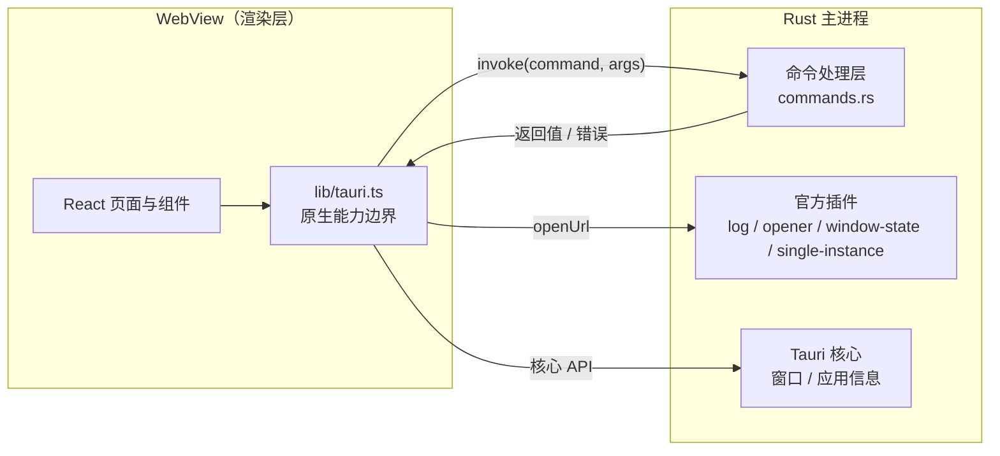

# 架构说明

## 一句话

React 负责界面与偏好，`src/lib/tauri.ts` 封装原生能力，Rust 负责命令与桌面生命周期。业务 IPC 当前使用请求 / 响应，另有窗口尺寸事件订阅；自定义业务事件可在需要时接入。

## 运行时结构



要点：

- WebView 没有 Node 环境；文件访问等操作需通过受限制的浏览器 API 或原生能力完成。
- 原生能力通过 Tauri 核心、已注册插件或自定义 Rust 命令提供，不需要为已有插件重复写命令。
- 当前自定义命令只有 `greet`；文件、网络、数据库与硬件访问尚未实现。后文的存储与事件方案是扩展约定。
- Tauri 核心与插件能力由 `src-tauri/capabilities/default.json` 分配；自定义命令另需应用 ACL 才受此限制，见 [安全规范](./security.md#能力最小化)。

## 前端分层

页面由路由表加载，外壳读取同一份路由元数据；复用逻辑与平台边界分开：

```
App.tsx ──> layouts/ ──> routes.tsx ──> pages/
   │            │                         │
   └────────────┴────> components/ <───────┘
                             │
                         hooks/ / providers/ / lib/
                                               │
                                      lib/tauri.ts ──> @tauri-apps/*
```

| 层            | 职责                                      | 不该做的事                          |
| ------------- | ----------------------------------------- | ----------------------------------- |
| `routes.tsx`  | 路由路径、标题、图标、页面组件            | 不放业务逻辑                        |
| `layouts/`    | 应用外壳（标题栏、侧边栏、内容区）        | 不写页面内容                        |
| `pages/`      | 路由级编排、组合组件                      | 不写复杂业务逻辑，不直接调 `invoke` |
| `components/` | 可复用的展示与交互单元                    | 普通展示组件不感知路由或业务状态    |
| `hooks/`      | 可复用的 React 逻辑（副作用、订阅、状态） | 不含 JSX，不承载业务规则            |
| `providers/`  | 跨页面的 React Context（外观偏好、i18n）  | 不放业务数据，不渲染页面结构        |
| `lib/`        | 纯 TS：IPC 封装、格式化、校验             | 不含 JSX，不 import React           |

`components/ui/` 保留上游组件的结构与导出方式，应用自有组件遵守分层约定。应用外壳组件 `title-bar.tsx` 可以导航并读取设置，`theme-toggle.tsx` 可以读取主题与翻译；这类组件须置于对应 Provider 内。

`layouts/` 负责路由页的整体布局：`AppShell` 用 `useLocation`、渲染 `Outlet`，所以它在 `layouts/`。标题栏等外壳部件仍放在 `components/`。

`components/error-boundary.tsx` 包在 `App` 外层（见 `main.tsx`）。这不是可选项：
窗口启动时是隐藏的，组件树一崩，用户看到的是 Rust 兜底线程弹出的空白窗口，
没有任何可反馈的信息。错误边界至少能把错误文本留在屏幕上。

**硬规则**：`@tauri-apps/*` 只允许出现在 `src/lib/tauri.ts`。
所有 IPC 调用收敛到这一个文件，带来三个好处：

1. 换实现（比如接入 `tauri-specta` 生成类型）只改一个文件。
2. 写测试时可以整体 mock 掉。
3. 一眼能看出这个应用到底用了哪些系统能力。

这条规则**由 ESLint 强制**，不是靠自觉：`eslint.config.js` 里同时配了
`no-restricted-imports`（静态 import）和 `no-restricted-syntax`（动态 `import()`）。
后者必不可少——本工程的 Tauri 调用全是动态引入，只配前者等于没配。

### 界面偏好与多语言

应用自有的全局 React Context 放在 `providers/`：

- `providers/settings.tsx`：外观偏好（主题色、圆角、字体、字号、背景、动效、语言、菜单栏），
  写入 `localStorage`，并把值映射到 `<html>` 的 `data-*`；样式全部由 `index.css` 接管。
  加设置项的顺序是「类型 → 默认值 → `applySettings` → CSS → 设置页」。
- `providers/i18n.tsx`：`[中文, English]` 字典 + `t(key, vars)`，不引入 i18next。
  新增文案必须两种语言都写，缺失时 TypeScript 会报错。
- `hooks/use-theme-switch.ts`：统一主题切换入口，View Transitions 的圆形扩散也在这里。

### 窗口外壳

窗口去掉了原生边框（`decorations: false`），标题栏由 `components/title-bar.tsx` 绘制：
拖拽区域用 `data-tauri-drag-region`，按钮调用 `lib/tauri.ts` 封装的窗口命令。

macOS 例外：`src-tauri/tauri.macos.conf.json` 把窗口改回 `decorations: true` +
`titleBarStyle: "Overlay"`，保留系统红绿灯；前端检测到 macOS 时会隐藏自绘按钮并让出左侧空间。

**注意**：平台配置按 JSON Merge Patch 合并，`app.windows` 数组是整体替换。
改窗口字段时 `tauri.conf.json` 与 `tauri.macos.conf.json` 必须同步，否则 macOS 会丢字段。

## 业务代码放哪

模板只有展示页，没有业务。真写起来按这个顺序找位置，别一上来就加层：

| 你要写的东西           | 放哪                                                 |
| ---------------------- | ---------------------------------------------------- |
| 一个页面               | `pages/`                                             |
| 只在这个页面用的子组件 | 和页面同目录，需要时把页面变成 `pages/xxx/index.tsx` |
| 跨页面复用的组件       | `components/`                                        |
| 一段带状态的复用逻辑   | `hooks/`                                             |
| 纯函数、格式化、校验   | `lib/`                                               |
| 需要 Rust 参与的能力   | `lib/tauri.ts` 加封装 + `src-tauri/src/commands.rs`  |

**什么时候升级成 `features/<domain>/`**：同一个领域同时出现「页面 + 组件 + 请求封装」，
且该领域文件超过 10 个时。提前建空目录只增加导航成本，不产生结构收益。

### 命令变多以后

`lib/tauri.ts` 现在是单文件。出现明显领域划分、难以独立维护时，可改成目录：

```
lib/tauri/
  index.ts      对外门面，页面只从这里 import
  env.ts        isTauri
  invoke.ts     统一 invoke 封装（错误归一化）
  app.ts        应用级命令
  fs.ts         文件相关命令
```

对外路径仍是 `@/lib/tauri`。拆分时同时更新 `eslint.config.js` 的原生 API 允许路径与边界测试，不能仅移动文件。

## 通信机制

### 请求 / 响应（invoke）

前端调 Rust，等返回值。适合"取数据、执行动作"。

```ts
// lib/tauri.ts
export async function invokeGreet(name: string): Promise<string> {
  if (!isTauri()) throw new Error("请用 pnpm app:dev 启动");
  const { invoke } = await import("@tauri-apps/api/core");
  return invoke<string>("greet", { name });
}
```

Rust 侧返回 `Result<String, String>`，`Err` 会原样 reject 到前端。
模板刻意让 `greet` 对空名称返回错误，而不是在页面里兜底——
**校验放在边界，错误由调用方展示**。照着这个写，错误链路天然是通的。

命令变多、同一类错误需要不同的用户提示或重试策略时，把 `String` 升级为结构化错误，
前端按类型分支，而不是解析错误字符串：

```rust
#[derive(Debug, serde::Serialize)]
#[serde(tag = "kind")]
pub enum CommandError {
    Validation { message: String },
    NotFound { message: String },
    Io { message: String },
}

#[tauri::command]
pub fn read_config() -> Result<String, CommandError> {
    // ...
}
```

```ts
try {
  const config = await invoke<string>("read_config");
  // 使用 config
} catch (error: unknown) {
  if (
    typeof error === "object" &&
    error !== null &&
    "kind" in error &&
    "message" in error &&
    typeof error.message === "string"
  ) {
    // 校验 error.kind 后决定提示文案与是否重试
  }
}
```

演进时机：只有一种错误时保持 `String`，错误分叉前不加层。

注意：`invoke<T>` 的泛型**不做运行时校验**，它只是一个断言。跨进程边界的数据要当成不可信输入，必要时用 zod 校验。

### 事件（emit / listen）

Rust 主动通知前端，或窗口之间广播。适合"进度更新、后台任务完成、菜单点击"。
当前没有自定义业务事件，需要时：

```rust
app.emit("download-progress", 42)?;
```

```ts
// 封装在 src/lib/tauri.ts，Hook 只调用此处导出的订阅函数
import { listen } from "@tauri-apps/api/event";
const unlisten = await listen<number>("download-progress", (e) =>
  setProgress(e.payload),
);
```

`listen()` 异步返回取消函数。Hook 需要在 effect cleanup 中取消监听，也要处理「组件已经卸载、注册才完成」的情况，不能直接把 Promise 作为 cleanup 返回。现有窗口订阅模式可参考 `components/title-bar.tsx`。

## 状态管理

按这个顺序升级，不要一上来就上库：

| 场景                                 | 方案                                    | 现在有吗         |
| ------------------------------------ | --------------------------------------- | ---------------- |
| 单个组件内部                         | `useState` / `useReducer`               | 有               |
| 兄弟组件共享                         | 状态提升到共同父级                      | 有               |
| 跨页面 UI 偏好（主题、字体、语言）   | `providers/settings.tsx` + localStorage | 有               |
| 跨页面业务状态（当前项目、协作状态） | Zustand                                 | 未安装，需要时装 |
| 来自数据库/接口、需要缓存与失效      | TanStack Query                          | 未安装           |
| 表单 + 校验                          | react-hook-form + zod                   | 未安装           |

判断标准：**能靠组件树解决的就别引入全局状态**。全局状态每多一个，调试成本就多一分。

## 数据存储

| 数据                           | 存哪                                  | 原因                               |
| ------------------------------ | ------------------------------------- | ---------------------------------- |
| UI 偏好（主题、语言、菜单栏）  | `localStorage`                        | 已实现，不需要 Rust 参与           |
| 原生窗口尺寸、位置与最大化状态 | `tauri-plugin-window-state`           | 已实现，存储于应用配置目录         |
| 业务数据                       | SQLite（`tauri-plugin-sql`）          | 事务、索引、迁移，比 JSON 文件可靠 |
| 用户导出文件                   | 用户明确选择的位置                    | 不强制写入应用数据目录             |
| 缓存、日志                     | `appCacheDir`、`appLogDir`            | 使用对应的系统目录                 |
| 令牌、密钥                     | 系统钥匙串（按需接入 Rust `keyring`） | 不落明文，不写进 localStorage      |

**绝对不要**把数据写到 exe 所在目录。Windows 下装在 `Program Files` 时是只读的，
开发机上能跑、装完就崩，这类问题排查成本极高。

获取路径：

```rust
let dir = app.path().app_data_dir()?; // 需要 tauri::Manager
```

## 安全边界

1. **能力白名单**：`src-tauri/capabilities/default.json` 限制 Tauri 核心与插件调用；自定义命令默认向本地前端开放，按窗口限制需另启应用 ACL。
2. **CSP**：生产 CSP 已内建，收紧规则见 [安全规范](./security.md#csp)。开发模式下页面由 Vite dev server（外部 URL）提供，Tauri 不注入 CSP，因此 HMR 不受限；`devCsp: null` 的语义是「开发构建回退到生产 CSP」，不是「开发模式没有 CSP」。
3. **不做动态代码执行**：不 `eval`，不加载远端 JS。
4. **外链隔离**：所有 http 链接由系统浏览器打开，不在 WebView 里导航。

## 目录职责速查

```
src/
  routes.tsx        路由与导航的唯一数据源
  layouts/          路由页的整体布局
  pages/            路由级页面，默认导出
  components/
    ui/             shadcn 原子组件（不改导出名）
    <domain>/       跨页面复用的业务组件
  hooks/            可复用的 React 逻辑，use-xxx.ts
  providers/        跨页面 React Context（外观偏好、i18n）
  lib/              纯 TS：IPC 封装、工具、校验
  styles/           内置的 shadcn 基础样式（上游逐字复制，勿手改）
src-tauri/
  src/lib.rs        组装：插件注册、命令注册、启动兜底
  src/main.rs       二进制入口，只调 lib.rs
  src/commands.rs   前端可调用的命令实现
  capabilities/     Tauri 核心与插件能力白名单
  tauri.conf.json   窗口、打包、标识符
```

`lib.rs` 只做组装。命令的实现写在 `commands.rs`，命令多了拆成 `commands/` 目录按领域分文件——
让「加命令去哪个文件」这个问题有明确答案，而不是把入口文件养成第二个业务层。

## 已知取舍

这些是有意为之，不是遗漏。改动前请先读 [ADR](./adr/README.md)。

| 取舍                               | 得到什么               | 失去什么                                        |
| ---------------------------------- | ---------------------- | ----------------------------------------------- |
| 用系统 WebView 而不是自带 Chromium | 无需随包携带浏览器引擎 | 三端渲染细节与系统 WebView 版本有差异           |
| HashRouter 而不是 BrowserRouter    | 自定义协议下刷新不 404 | URL 里带 `#`，不好看                            |
| 不建 `features/` 层                | 目录浅，找文件快       | 单领域文件超过 10 个时要重构                    |
| 不预装状态管理库                   | 起步轻，没有多余概念   | 跨页状态变多时需要补                            |
| 使用内置中英文字典                 | 零额外依赖，即时切换   | 复杂复数、日期等本地化需另行扩展                |
| 剪贴板不用官方插件                 | 少一个 Rust 依赖       | 个别 WebView 组合下可能失败，已做 textarea 回退 |
| `invoke` 泛型不做运行时校验        | 简单、零开销           | 后端返回结构变了前端不会立刻报错                |
