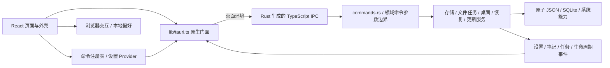

# 架构说明

本文记录当前运行方式、模块职责与数据边界。体验、扩展和裁剪步骤见 [模块指南](./demo-modules.md)，插件协议见 [扩展指南](./extensions.md)。多人、多业务域的演进方式见 [规模化开发指南](./engineering-at-scale.md)，其中的示例不代表当前已实现。

## 运行时结构

前端入口为 [`index.html`](../index.html) → [`main.tsx`](../src/main.tsx) → [`App.tsx`](../src/App.tsx)。App 组合设置、语言、主题、命令、扩展和未保存工作 Provider，以及 DemoMotion 与 HashRouter；RecoveryGate 确认原生存储状态后才挂载业务路由。主 / 次窗口使用 [`AppShell`](../src/layouts/app-shell.tsx)，扩展独立窗口使用单独的窗口路由。原生入口为 [`main.rs`](../src-tauri/src/main.rs) → [`lib.rs`](../src-tauri/src/lib.rs)，后者负责插件、共享状态、命令和生命周期组装。

桌面和浏览器共用 `src/` 与 HashRouter，刷新深层链接不依赖服务器解析应用路由。桌面由 Tauri 加载 `dist/`；浏览器演示使用相对资源路径输出到 `dist-web/`，支持项目子路径部署。浏览器可运行本地交互与偏好，系统调用仍由门面检查环境；构建与部署见 [开发指南](./development.md#浏览器演示构建与部署)。

## 模块职责

| 位置                                                                            | 职责                                                                   |
| ------------------------------------------------------------------------------- | ---------------------------------------------------------------------- |
| `src/routes.tsx`                                                                | 页面懒加载、预载、路径、导航分组和演示标记                             |
| `app.config.json` / `src/config/app.ts`                                         | 应用身份、品牌及默认配置；初始化与派生规则见开发指南                   |
| `src/commands/` / `providers/commands.tsx`                                      | 菜单、命令面板与快捷键共用的注册、可用性和执行入口                     |
| `src/components/` / `src/layouts/` / `src/styles/`                              | 外壳、交互及样式；`components/ui/` 为共用原子控件                      |
| `src/features/`                                                                 | 已形成独立规则的领域；路由页面仍在 `pages/`                            |
| `src/components/workbench/`                                                     | 当前 WebView 的文件草稿、预览与跨路由编辑状态                          |
| `src/providers/settings.tsx` / `lib/settings-model.ts` / `lib/settings-sync.ts` | 设置上下文与生命周期、迁移校验、字段合并及 revision 同步               |
| `src/providers/unsaved-work.tsx` / `hooks/use-task-notifications.ts`            | 离页后的脏工作回调、任务通知及退出前等待 / 取消                        |
| `src/hooks/use-workspace.ts` / `use-native-resource.ts`                         | 工作区与激活交接；原生数据加载、错误和过期结果隔离                     |
| `src/hooks/use-demo-motion.ts` / `components/demo-motion.tsx` / `src/i18n/`     | 动效活动状态；类型化词典、语言注册与回退                               |
| `src/lib/tauri.ts` / `src/lib/generated/bindings.ts`                            | 手写应用的原生门面；Rust 导出的底层 IPC 契约                           |
| `src-tauri/src/commands.rs` / `*_commands.rs` / `bindings.rs`                   | 基础 / 领域命令边界与编排；命令和 DTO 导出注册                         |
| `blocking.rs` / `error.rs` / `redaction.rs`                                     | 阻塞任务适配、结构化错误与基础脱敏                                     |
| `storage.rs` / `database.rs` / `data_commands.rs`                               | 原子设置；SQLite 迁移、事务、版本、草稿及逻辑备份                      |
| `network.rs` / `demo_http.rs` / `network_commands.rs`                           | 原生 HTTP 连接偏好与请求头规则；有界演示请求及按窗口取消               |
| `workbench.rs` / `workbench_commands.rs`                                        | 文件授权、条件保存、扫描 / 哈希队列和持久历史                          |
| `desktop.rs` / `window_geometry.rs` / `autostart.rs`                            | 窗口与托盘、逻辑尺寸和位置适配、平台自启动                             |
| `lifecycle.rs` / `system_commands.rs` / `recovery.rs`                           | 退出协商；工作区、激活、凭据与固定 worker；启动隔离和重启恢复          |
| `extensions.rs` / `extension_*.rs`                                              | 扩展安装、执行、授权、受控服务、界面、市场与旧数据恢复，分工见扩展指南 |
| `diagnostics.rs` / `updater.rs` / `src/lib/updates-store.ts`                    | 脱敏诊断；原生更新句柄与各 WebView 的进度快照                          |
| `sdk/` / `examples/extensions/` / `marketplace/`                                | 界面 SDK、互操作示例、独立市场子模块                                   |
| `resources/branding/` / `scripts/branding.mjs` / `scripts/fs-utils.mjs`         | 品牌生成；初始化和版本脚本共用的暂存、冲突检测与回滚                   |

Rust 表项未写完整路径时均位于 `src-tauri/src/`。小领域继续放在现有页面、组件、Hook 和服务中，按实际规则内聚，避免预建空壳层。基础契约与纯模型由各自目录维护，Provider 负责 React 上下文与生命周期；启动、恢复和纯逻辑模块直接引用所属模型，不经 Provider 重导出获取基础类型。错误模块与诊断服务共同依赖基础脱敏模块，错误处理不反向依赖聚合诊断。

## 页面与演示边界

路由、导航与页面命令复用 [`routes.tsx`](../src/routes.tsx)。完整 demo、`minimal` 的展示范围、各页数据生命周期及兼容入口统一见 [体验现有模块](./demo-modules.md#体验现有模块)；隐藏入口不会移除原生能力。

页面按需加载，静态与动态插件侧栏入口的悬停、键盘聚焦只预载模块，不挂载页面、运行 Wasm 或执行 IPC。普通页面的 Suspense 按 pathname 重建，未加载页面显示共用 PageLoading 骨架；路由错误边界随导航清除已捕获的错误，重复导航当前页面或改变查询参数时保留正常页面的状态，不因错误边界重建而重复加载数据。插件结果仅在出现 Markdown 块时加载对应解析器，HTML 插件与普通表单首屏不等待该依赖。外壳提供标题栏、可调宽侧栏、位置提示和独立滚动区，布局与焦点规则见 [界面规范](./conventions/ui-guidelines.md#布局常量)。

`features/journeys/` 用 URL 的 `journey` / `step` 参数表示跨页导览，校验路线、步骤和页面是否匹配；只提示与导航，不执行操作、推断完成或持久化流程。演示表单、CSV 和 fixture 不写原生数据库；原生页面在浏览器显示环境说明，通信页保留可提交表单，实际调用仍由门面拒绝不支持的环境。

DemoMotion / useDemoMotion 协调用户偏好、系统减少动效、文档可见性和场景离屏状态；CSS 与命令式循环仍须消费活动状态并清理资源，见 [动效规范](./conventions/ui-guidelines.md#动效)。文件和笔记的差异合并只更新编辑器及已审阅版本，保存仍由原服务执行条件写入，见 [数据工作流与冲突比较](./demo-modules.md#数据工作流与冲突比较)。

扩展由 ExtensionsProvider 汇集安装快照、每窗口会话和动态入口，命令复用 CommandsProvider。Rust 在启用提交前仅编译模块，应用重启后也可后台预热已启用模块；编译不创建实例或调用导出。实际调用仍复核安装身份、授权和窗口，再通过固定无界面 worker 创建独立实例，编译缓存与队列有界；方案见 [ADR 0017](./adr/0017-precompile-enabled-extensions.md)。声明式结果由共用渲染器呈现，随包 HTML 在隔离框架内通过受限消息桥交互，可信宿主窗口负责系统能力。安装替换 / 回退更换 generation，身份相关调用同时复核 generation 与模块哈希；旧会话不能继续操作新安装。预热预算、取消、服务租约、界面会话及环境同步细节统一见 [扩展指南](./extensions.md#执行存储与生命周期)。

AppShell 通过 [ExtensionOutlets](../src/layouts/extension-outlets.tsx) 保留最近使用的最多 3 个插件页面；容器按稳定 DOM 顺序挂载，非当前页面使用 `hidden` / `inert`，避免重排 iframe 导致重建。活动状态控制隐藏页面的请求、轮询、语言刷新、尺寸观察和首屏计时；LRU 移出只释放界面与端口，会话缓存仍保护未保存草稿和在途操作。包身份失效、禁用或必需授权撤销立即释放旧界面，可选授权变化同步最新快照。限额、兼容与取舍见 [ADR 0016](./adr/0016-retain-extension-surfaces.md)，具体契约见 [自定义界面](./extensions.md#自定义界面)。

会话缓存只回收非活动的干净工作，凭据系统调用按插件协调，不持全局注册表锁等待外部服务。隔离 HTML 通过 SDK 消费语义 token 和基础控件规则，Shadow DOM 由作者显式接入，不共享宿主组件实例。SDK 公共 DTO 从 Rust 生成绑定提取闭合依赖，独立插件开发无需引用宿主源码树；公开入口与一致性边界见 [界面 SDK](../sdk/README.md)。

命令清单可选择标准或计算预算；原生执行、效果往返、离线 CLI 与预编译均使用已校验清单的档位，编译缓存按预算区分。选择只改变有界 Wasm fuel，不新增权限或延长墙钟；版本与限额见[扩展指南](./extensions.md#执行存储与生命周期)，取舍见 [ADR 0019](./adr/0019-bounded-extension-compute.md)。

## 命令与桌面交互

菜单、命令面板和快捷键共用注册与执行入口，按路由、模式及原生环境判断可用性。快捷键集中处理 Cmd / Ctrl、输入框、输入法组合输入、重复按键与冲突。设置搜索使用稳定控件锚点；内容搜索只查询笔记与已授权最近文件，不扫描磁盘，结果经既有命令导航并保留脏编辑确认。

主 / 次窗口固定为 `main` / `secondary`，重复打开次窗口会聚焦已有实例；扩展窗口使用宿主生成的 `extension-*` 标签。窗口共用原生设置与数据库，各自保留渲染状态。单实例插件先初始化，重复启动请求异步交给激活流程；主窗口配置 `create: false`，待原生状态就绪后从阻塞任务池创建。

窗口初始隐藏，App 的 [`useRevealWindow`](../src/hooks/use-reveal-window.ts) 等两次动画帧后握手显示，Rust 提供三秒兜底。显示握手不等待路由或数据完成，不能作为页面可交互的性能证据。窗口状态插件恢复位置和显示状态，`window_geometry.rs` 独立持久化逻辑尺寸；旧物理尺寸仅供首次迁移，避免重复恢复。DPI 与工作区变化触发有界适配，不在持有插件锁时同步修改几何；存档由后台 worker 写入。

启动位置 `remember` / `center` 仅用于新建窗口，重复激活与切换偏好不重新定位当前窗口。初始化按可用工作区调整，临时缩小保留首选尺寸，普通移动不持续吸附边缘。尺寸预设使用 DIP，应用前还原最大化 / 最小化 / 全屏，持久化完成后命令才返回。相关平台限制与排查见 [窗口排障](./troubleshooting.md#远程桌面断开后窗口过大或落在屏幕外)。

主 / 次窗口启用后台运行且托盘可用时关闭改为隐藏，扩展窗口仍正常关闭。关闭、退出、重启和安装更新共用 `lifecycle.rs`：收集相关窗口的脏工作，保存 / 放弃成功后继续，失败或取消则保留窗口。生命周期操作从协商到实际执行保持互斥，与窗口创建协调，防止新窗口绕过协商快照；关闭获准后拒绝该窗口的晚到扩展调用，并等待在途执行结束。

UnsavedWorkProvider 保留离页后的保存回调；主窗口登记后台任务，“保存”表示等待完成，“放弃”表示合作取消并等待 worker 退出。前端停止等待不能回滚已写入或已取消的工作。浏览器保留 `beforeunload` 提醒，但不能控制全部外部关闭方式。

工作区仅恢复主 / 次窗口的非隐藏静态路由及次窗口打开状态，不持久化动态扩展会话路径。文件关联在原生授权与读取验证后发布资源 ID、文件名及错误，不缓存正文；主窗口先订阅再读激活快照，通过 ID 去重，既有文件加载 IPC 完成交接。接收、读取和缓存均有界，旧结果不能覆盖较新导航或用户编辑，授权淘汰后需重新选择。限制与具体协议以 [`system_commands.rs`](../src-tauri/src/system_commands.rs) 和 [`use-workspace.ts`](../src/hooks/use-workspace.ts) 为准。

深链与文件关联身份由 `app.config.json` 的 `integration` 统一定义，见 [派生系统身份](./demo-modules.md#派生系统身份)。深链只导航允许的本地路由；本地 `file:` URL 经标准路径解码，拒绝远端主机、凭据、查询与片段。系统快捷键只允许预定义组合，自启动由用户主动开关；E2E 构建禁止系统自启动与凭据操作。关联、深链、通知等仍需目标平台安装版验收。

## 通信机制

Rust 命令和 DTO 是 IPC 类型来源。命令标注 `#[tauri::command]` / `#[specta::specta]` 并在 `bindings.rs` 注册后，运行 `pnpm bindings:generate` 与 `pnpm bindings:check`，提交生成的 [`bindings.ts`](../src/lib/generated/bindings.ts)。完整跟做示例见 [新增页面到 IPC 与测试](./demo-modules.md#新增页面到-ipc-与测试)。

页面、组件和 Hook 仅依赖 `lib/tauri.ts`，由门面加载生成命令、检查环境并归一化结果；不手改生成文件、不拼命令字符串、不再写一套 DTO。命令返回 `NativeResult<T>`，错误包含 `code`、`message`、`retryable`；前端按稳定 code 分支，不解析错误文本或直接 `String(error)`。生成类型不能替代 Rust 的入参、大小和路径校验；阻塞 I/O 通过 `blocking::run` / `spawn_blocking` 移出异步线程。

设置与任务事件携带 revision，笔记事件通知重查，更新事件含 operationId 和阶段，退出协商使用请求 ID。订阅后再读快照，按各自版本或操作身份过滤旧消息，不假设事件与命令返回在跨窗口具有统一顺序。事件不是持久消息队列，写入结果以命令返回为准。

事件门面显式监听当前 WebviewWindow，避免全局 `Any` 监听收到其他窗口的定向事件；原生广播仍可匹配窗口目标。异步订阅须在卸载、StrictMode 重建及取消函数晚到时释放，回调也要检查订阅是否已失效。

## 状态管理与设置迁移

页面状态留在组件；跨页偏好由 SettingsProvider 管理，命令由 CommandsProvider 管理，文件草稿使用当前 WebView 的外部 store。TanStack Query 与 React Hook Form 只服务各自领域示例，不取代原生设置、数据库或任务服务的权威状态。

设置 schema 与迁移由 [`settings-model.ts`](../src/lib/settings-model.ts) 定义，读取旧扁平格式、schema 1 包装格式与后续兼容版本，按白名单规范化字段；未来 schema 阻止自动覆盖，明确重置后才可替换。首次语言匹配系统偏好，已保存选择优先，重置保留语言。主题进入同一模型；只有模板原命名空间兼容通用旧 `theme` 键，避免派生应用继承其他站点偏好。

桌面以 `settings.json` 为权威快照，使用原子替换与 revision compare-and-swap。Rust 校验结构、额度及原生使用字段；前端负责迁移与未来 schema 保护。SettingsSync 分离未提交与在途字段，冲突后重读并有限重试，失败保留修改；跨窗口只接受新 revision。浏览器独立使用 localStorage，各标签页维持自己的已加载偏好，刷新后读取最后保存的设置。两种环境均不以其他窗口的主题缓存事件直接改色，避免绕过设置模型或形成反复回写；桌面的本地缓存仅供首屏与旧设置迁移。

宿主“设置 → 网络”的 `networkMode` 统一管理后续原生 HTTP：默认 `system` 跟随系统 / 环境代理，`direct` 禁用代理。市场、应用更新、网络演示和扩展请求读取已保存偏好，不修改进程代理环境，也不重启或改写已开始的操作；单次市场操作的目录刷新和包下载共用开始时的模式。更新下载前重新读取，检查后切换连接方式仍可生效。浏览器 fetch、WebView WSS、系统浏览器外链和 LAN 连接由各自环境管理，浏览器预览禁用该选项。

该字段是现有设置 schema 的可选增量，旧存档缺失时采用默认值，无需升级 schema 或新增授权。扩展缺省继承宿主，但代理仍受独立授权约束；旧显式模式和环回请求的兼容规则集中在 [来源与授权](./extensions.md#来源与授权)。连接选择不放宽已有 URL、来源、DNS、TLS 和签名边界；设置迁移、切换生效与扩展授权矩阵的验收入口见 [Rust 测试](./testing.md#rust-测试)。

读取原生设置时，只有可读、未超限但内容损坏的文件才能先备份为 `settings-corrupt-*.json` 再恢复空快照；读取、超限或备份失败交给启动隔离处理，保留原件。浏览器读取 / 解析失败时保留原存档，修改暂留内存；重试先成功读取，再合并期间明确修改的字段，明确重置才可直接替换。

恢复默认设置同时恢复已打开及已记忆窗口的默认尺寸，并约束到工作区；启动位置恢复 `remember`，保留当前位置及必要的可见性修正。尺寸与偏好依次持久化，各有独立失败边界，失败保留确认与重试；不删除笔记、日志、图库或 WebView 数据，也不修改系统自启动。自定义背景与独立图库的存储关系见下节。

`browserStorageNamespace` 隔离设置键、主题缓存、图库 IndexedDB 与广播通道。初始化改应用标识时默认改用新 identifier，切换不会删除或自动导入旧数据；它区分同源应用数据，不构成脚本安全隔离，见 [项目初始化](./development.md#项目初始化)。

## 数据存储

| 数据                    | 位置与边界                                                                                                  |
| ----------------------- | ----------------------------------------------------------------------------------------------------------- |
| 设置、窗口存档          | `appConfigDir`；设置原子写入，保留损坏备份和未来 schema 保护                                                |
| 笔记数据库              | `appDataDir/starter.sqlite3`，由 Rust rusqlite 持有连接                                                     |
| 笔记备份                | `appDataDir/backups/`；版本化逻辑 JSON，包含全部笔记、回收站与窗口草稿                                      |
| 文件与任务              | 外部文件须明确授权；记录、任务历史与报告在 `appDataDir/workbench/`                                          |
| 壁纸图库                | 桌面 `appDataDir/wallpapers.json` 原子更新；浏览器为独立 IndexedDB；不在笔记备份内，隔离恢复使用临时图库    |
| 扩展安装与市场信任      | `appDataDir/extensions/` 与 `extension-market/`，不在笔记备份或恢复归档内                                   |
| 扩展私有数据与 LAN 历史 | `appDataDir/extension-data/`；KV / 凭据别名与 `lan/` 聊天历史及有界附件缓存分别管理，不随会话导出或笔记备份 |
| 扩展图片资源            | 有界短期内存缓存，与插件身份、窗口和有效期绑定，不持久化或随会话恢复授权                                    |
| 日志与浏览器缓存        | `appLogDir` 轮换日志；localStorage 仅保存非敏感偏好                                                         |
| 用户凭据                | keyring 保存应用演示项和按插件 / origin / 别名隔离的秘密，JSON 仅存别名元数据                               |

数据目录由 Tauri 路径 API 决定，不写入 exe 所在目录。扩展各存储、系统凭据及生命周期的边界统一见 [扩展指南](./extensions.md#执行存储与生命周期)，日志见 [排障手册](./troubleshooting.md#先看日志)，测试目录隔离见 [真实桌面 E2E](./testing.md#真实桌面-e2e)。

壁纸图库最多 24 张，每张保存经重编码的 JPEG / WebP data URL，连同前缀最多 96 KiB；以内容 SHA-256 去重，不保存原图路径、远端 URL 或 SVG。设置中的 `customBackground` 另存当前选择的自包含副本、名称和填充方式：切换内置皮肤保留选择，取消图片背景或重置偏好清除副本但保留图库，缺少合法图片时回落纯色。首次建立图库可导入旧设置副本，已有图库不重复迁入；未知版本或损坏内容拒绝写入，不清空重建。额度与兼容实现见 [`wallpapers.rs`](../src-tauri/src/wallpapers.rs)、[`wallpaper-library.ts`](../src/lib/wallpaper-library.ts) 和 [`background-image.ts`](../src/lib/background-image.ts)，历史决策见 [ADR 0004](./adr/0004-wallpaper-library.md)。

SQLite 用 `PRAGMA user_version` 标记 schema，迁移在事务中完成，未来版本拒绝修改。查询分页，更新与批量回收 / 恢复 / 永久删除校验 `expectedVersion`，整批冲突回滚；不向前端开放任意 SQL、数据库路径或通用文件权限。笔记草稿按窗口标签持久化，读取完成前暂停编辑与备份写入，保存正式笔记和放弃草稿各有独立动作并参加退出协商。

逻辑备份取一致快照后释放数据库锁，再校验和写盘；坏备份保留原件，其他健康项仍可用。恢复先验证格式与数据，保存当前完整安全备份，再事务替换并重新分配版本以拒绝旧编辑；恢复后的草稿读取失败只重试读取。备份不包含设置、凭据、日志、图库、扩展或外部文件，不提供云端恢复。

外部备份导入限 16 MiB、50,000 条笔记与 128 份草稿，超限拒绝且不截断。应用生成的完整备份不套用外部额度，较大备份可在原目录预览、恢复、原生导出和用于启动恢复；导出后经外部导入仍受上述限制。当前使用完整内存 JSON 快照，不支持任意规模或流式跨安装导入。

文件工作台只接受原生选择、关联或拖入授权，后续以资源 ID 访问；文本最多 2 MiB，图片最多 8 MiB 且只读。JSON 与应用专属文档保存前校验，Markdown 不执行 HTML。保存先写同目录临时文件、比较原内容 SHA-256，再原子替换；外部冲突保留草稿，提供审阅与另存。这不是跨进程锁，仍存在最终检查与替换间的竞态。

扫描 / SHA-256 在 Rust 阻塞任务池运行，最多 2 项执行、10 项 FIFO 排队；排队直接取消，运行合作取消并等待释放执行位。离页 / 隐藏不停任务，重启标记 `interrupted`，重试从头运行；最近保留 30 项，完整报告可导出。超文件数或深度限制时标记截断，具体额度见 [`workbench.rs`](../src-tauri/src/workbench.rs) 常量。

任务历史和事件保留结构化错误、不可读条目计数及报告写入状态，由界面按当前语言显示原因与恢复方式。新增字段在读取旧历史时采用缺省值，不升级设置或数据库 schema；旧的文本诊断保留在可展开区域及导出报告中，不通过解析错误文本推断原因。首次快照未返回时显示加载状态，读取失败提供原位重试，成功收到空快照后才显示空态。

## 恢复、诊断与更新

根错误边界处理 App 渲染失败，路由边界保留外壳与导航并支持重试。操作失败保留输入与已有数据。诊断和恢复共用 `/diagnostics`；正常运行时旧 `/recovery` 跳转到恢复区，启动隔离时保留原恢复页面。

设置或数据库打开失败时，`recovery.rs` 建立临时设置、数据库和工作台，RecoveryGate 只允许恢复与诊断路由，临时数据不覆盖正式存档。用户预览受控备份并确认后暂存待替换文件；下次启动在正式连接前归档原数据库、WAL / SHM 与可选设置，按恢复日志安装，失败回滚并保留归档。候选设置只读校验，损坏或未来版本必须拒绝，不能套用默认重置后安装。目录不可写等故障仍可能阻止恢复，保留原因与原件；该流程不等于已完成目标平台故障演练。

诊断报告包含应用、平台、窗口、设置 revision、数据库版本和有限日志，不采集完整设置、笔记或环境变量。前端异常记录限速，日志预览脱敏，复制反馈前仍需复核。

更新由 Rust 持有检查结果、下载安装句柄和进度，前端各窗口订阅快照；设置区挂载不自动检查或重复订阅，主窗口启动检查偏好单独持久化。公钥为空时禁用且不联网，后台检查不下载或安装。下载验签后、实际安装前重新协商全部窗口，安装期间保持生命周期占用，失败 / 取消解除等待；不能以前期确认代替安装时确认。端点、超时、签名与发布验收统一见 [自动更新](./build-release.md#自动更新)。

## 安全边界

核心与插件权限由 [`capabilities/default.json`](../src-tauri/capabilities/default.json) 和 [`capabilities/extensions.json`](../src-tauri/capabilities/extensions.json) 按窗口分配；自定义命令的应用 ACL 与插件 capability 是不同机制，见 [能力最小化](./security.md#能力最小化)。主 / 次窗口与扩展宿主窗口是可信本地界面，不直接加载第三方网页；插件 HTML 使用隔离消息桥。

CSP 限制脚本与网络来源，外链经受控入口交给系统浏览器。数据库、设置、更新与自启动由限定服务负责，新增页面不会自动获得文件、Shell 或 SQL 权限。浏览器遵循同源存储和浏览器权限，没有可调用的 Rust 进程；IPC、网络、凭据和导入边界统一见 [安全规范](./security.md)。

## 扩展原则

新增语言复用 locale 注册表，新增操作复用命令注册表，新增原生能力复用生成绑定与门面。跨模块、数据兼容、权限、窗口生命周期或发布恢复的变更先完成 [设计影响分析](./engineering-at-scale.md#设计评审与-adr-门槛)，长期取舍记入 [ADR](./adr/README.md)。当前不包含移动端交付；新增平台、远程内容或敏感存储须独立设计与验证。
